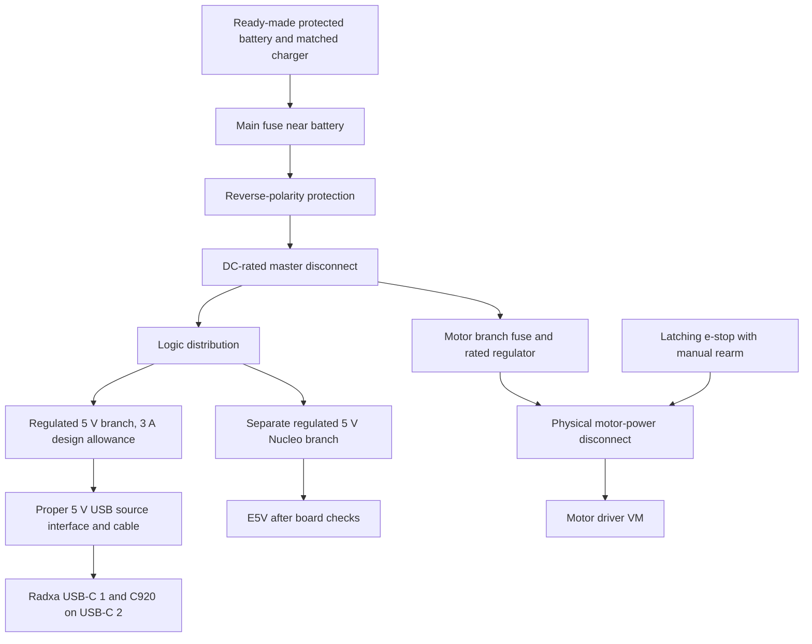

# Power plan

**Planned and untested.** This is research for the NUCLEO-G474RE and Radxa
ZERO 3W, checked on 11 October 2026. None of these power arrangements has
been tested on the boards. No hardware milestone has passed. This does not
change the [wiring plan](../hardware/wiring.md).

I want to measure the first build before buying a bigger battery. For P1 on
the bench, the proposed starting point is computer USB for the Nucleo and
a suitable spare supply for the Radxa. Motor power comes later, at the motor
milestone. The shared battery below is a later design proposal.

## The Nucleo power selector

The researched schematic is **MB1367-G474RE D01**, dated 26 September 2025.
Its JP5 selects which source feeds the board's 5 V rail. Check the revision
printed on the delivered board before using this table. [ST schematic, sheets
6 and 7][st-schematic]

| JP5 pins | Source | What the schematic shows |
| --- | --- | --- |
| 1-2, default | `5V_USB_STLK` | CN1 USB power through U4, the ST-LINK-controlled switch |
| 3-4 | `5V_VIN` | VIN through U11, the 5 V linear regulator |
| 5-6 | `E5V` | External regulated 5 V directly into the selected rail |
| 7-8 | `5V_USB_CHGR` | CN1 USB power before U4, bypassing that switch |

The default path needs successful USB enumeration before ST-LINK enables
target power. A power bank with no USB host cannot be relied on in that mode.
The charger position is the documented non-host alternative. [ST manual,
Rev 7, section 7.4, pages 16-20][st-manual]

| Other input detail | Published value | Source |
| --- | --- | --- |
| VIN | CN6 pin 8 or CN7 pin 24; 7-12 V. Current allowance falls from 800 mA at 7 V to 250 mA at the upper range | [ST manual, table 6][st-manual] |
| E5V | CN7 pin 6; 4.75-5.25 V, 500 mA | [ST manual, table 7][st-manual] |
| USB charger | CN1, 5 V; table leaves maximum current unstated | [ST manual, table 8][st-manual] |
| External 3.3 V | CN6 pin 4 or CN7 pin 16; 3-3.6 V, 1.3 A. ST-LINK is unavailable in this mode | [ST manual, section 7.4, page 21][st-manual] |

The VIN and charger paragraphs say **JP2**, while table 4 and the schematic
say **JP5**. USB budgeting also differs: the manual mentions 500 mA overall
but warns above 300 mA. Use the conservative limit pending clarification.
[ST manual, section 7.4, pages 16-20][st-manual]

The circuit explanation matters here. U4 is an STMPS2151STR between
`5V_USB_CHGR` and `5V_USB_STLK`, with `T_PWR_EN` controlling it. My inference
is that selecting the charger rail removes both the enumeration dependency
and U4's protection from the target's supply path. It does not turn an
unprotected source into a protected supply. [ST schematic, sheet 7][st-schematic]

For a later regulated 5 V rover branch, **E5V is my preferred proposal**:
JP5 5-6, E5V on CN7 pin 6 and ground on CN7 pin 8. Confirm the delivered
revision, polarity and voltage first. Do not put 5 V into VIN or feed a
battery directly into E5V. Use an externally protected branch. [ST schematic,
sheet 6][st-schematic]

Do not move jumpers now. For P1's counter test, keep the documented default
and connect only computer USB. Any later charger/E5V test needs its own
board-revision check. External power plus a computer debug cable is a separate
documented procedure, not permission to connect arbitrary supplies together.
[Existing counter instructions](software_prep.md#milestone-1-when-the-nucleo-arrives)

## Will a power bank stay on?

Anker explains that low-current devices can fall below a bank's detection
threshold. Its generic examples are 30-90 mA, not a universal threshold.
That makes Nucleo-only operation a possible problem, but the actual Nucleo
and bank combination has not been measured. [Anker low-current explanation][anker-mode]

Always-on banks do exist. Voltaic says its V25, V50 and V75 USB-A outputs
can stay on at low current. This still depends on charge remaining and the
pack's protection limits. A UK V25 listing was £59.99, with 5 V/2 A per
USB-A output and 3 A combined. It does **not** give one USB-A port the proposed
Radxa 3 A allowance. Delivery cost was not shown. [Voltaic][voltaic],
[UK listing][v25-uk]

Anker's UK instructions for PowerCore Essential 20000 describe a trickle
mode enabled by pressing the button twice, but it ends after two hours.
That is a timed low-current mode, not an indefinitely always-on supply.
A current UK offer for that exact model was not verified. [Anker UK instructions][anker-uk]

Radxa states 5 V input through **USB-C 1**. Its preparation guide recommends
at least 5 V/2 A and its PD30W adapter, while FAQ question 5 recommends at
least 15 W for stable operation. At 5 V, 15 W means 3 A. These pages give
different starting allowances; neither gives measured idle/peak current or
guarantees that an arbitrary bank stays on. The proposed **5 V/3 A branch**
matches that FAQ allowance, but is not a measured draw or proof that the
board plus every accessory fits it. [Preparation guide][radxa-power],
[FAQ][radxa-faq]

My proposed bank check is to test each output separately and together,
including the lowest-load state and recovery after shutdown. A running Radxa
may keep a shared bank active, but I have not verified whether a chosen bank
detects load per output. Do not assume it does. This check follows the
low-current behaviour described by [Anker][anker-mode].

## My proposed USB host fix

**My idea is to power the Nucleo from the Radxa's USB host port, with the
Radxa powered by the power bank and a hub for the C920.** That gives ST-LINK
a real USB host for enumeration while keeping the default Nucleo power
selection. I haven't tested this on the hardware. It is a proposed solution,
not a confirmed fix or a change to the wiring diagram.

The proposed connection is power bank to Radxa USB-C 1, then USB-C 2 through
a data adapter to a hub. The C920 and the Nucleo's Micro-B data lead connect
to separate hub ports. Motors stay disconnected for these bench checks.
The source routes come from [Radxa's interface guide][radxa-usb] and the
[ST power schematic][st-schematic].

### The two Radxa USB ports

| Port | Official description | What remains unverified |
| --- | --- | --- |
| USB-C 1 | USB 2.0 OTG and the main 5 V power input | Host data while receiving power needs a suitable adapter and host configuration; the official interface page does not guarantee that combination on our image |
| USB-C 2 | USB 3.0 host | The actual hub, C920 and ST-LINK combination has not been tested |

Source: [Radxa hardware interface page][radxa-usb]. The product brief,
section 6.2, says the host port is "constrained to a maximum electrical
current of 500mA". I will treat **500 mA as the published board budget**, not
as a general statement about every USB 3.0 port. [Radxa product brief][radxa-brief]

There is a different number in the protection circuit. V1.12 sheet 17 shows
U11, SY6280AAC, with R70 at 4.7 kΩ. The chip data sheet gives
`I_limit = 6800 / R_set`, so `6800 / 4700` is about **1.45 A nominal**.
This is a calculated protection threshold, not permission to draw 1.45 A
from the board. It has tolerance, and the cable and board rail matter too.
[Radxa schematic][radxa-schematic], [Silergy data sheet][sy6280]

Silergy describes current limiting under overload, then thermal shutdown
and recovery if a fault persists. It does not establish what this complete
board does at 501 mA. Whether an overload causes voltage droop, USB dropouts
or a board reset is **unverified**. Reverse-current blocking is described
when the switch is disabled, which does not prove that a powered hub cannot
back-feed the board. [Silergy data sheet][sy6280]

There is an enumeration issue as well as an electrical one. ST's manual
says the Nucleo requests 500 mA before enabling target power. It also gives
a 300 mA external-power caution and elsewhere describes a 300 mA request.
Inspect the actual ST-LINK descriptor instead of assuming which figure the
delivered firmware uses. [ST manual, pages 17 and 22][st-manual]

Linux's USB configuration code can reject a configuration whose advertised
power exceeds the available bus budget. Therefore a bus-powered hub might
fail to start the Nucleo even when measured consumption is low. That is an
inference from the code and ST's power sequence, not a reproduced fault on
the Radxa Bookworm image. [Linux USB source][linux-budget]

### Ways to connect both devices

All four options are **planned and untested**. Prices below were visible
on 11 October 2026. They are examples, not a delivered total or parts cleared
for purchase.

| Option | How I would test it | Main limits and risks | UK example |
| --- | --- | --- | --- |
| Small bus-powered hub on USB-C 2 | Both data leads go to the hub; all power comes through the Radxa host port | Hub plus camera plus Nucleo share the published 500 mA budget. Requested USB power can prevent configuration. Startup drops and camera bandwidth still need testing | TP-Link UH400 at Argos, **£8.99**. Delivery and local stock not shown. Compact with a built-in lead; exact dimensions and upstream isolation not shown on that page. [Listing][hub-bus] |
| Externally powered hub on USB-C 2 | Hub uses its own specified supply; its upstream data lead goes to the Radxa | Check upstream back-feed before connecting it. Its supply must suit the hub, not just have a USB connector. A powered hub can leave the Nucleo on while the Radxa is off | TP-Link UH700 at CPC, **£23.95 ex VAT / £28.74 inc VAT calculated at 20%**, 24 in stock when checked; delivery cost not shown. [Listing][hub-powered] |
| USB-C 1 host/power splitter | Power enters the splitter; a data socket serves the Nucleo, leaving USB-C 2 for the C920 | Simultaneous host/power behaviour, CC signalling, boot order and isolation are unverified for our adapter and OS. Do not connect two power sources or assume a PD label makes it work | Innov8 splitter, **£4.95 inc VAT**, re-stocking soon; UK delivery shown as £1.75. It claims simultaneous power/data, but Radxa compatibility is not shown. [Listing][otg-offer] |
| Radxa header 2/4 to Nucleo E5V | A later protected 5 V lead could feed the selected E5V input; UART would carry data | Header external current allowance is not published in the checked Radxa material. Voltage alone is insufficient. Source selection, polarity and protection need checking; keep this route disconnected | A suitable protected lead has not been selected or priced. [Radxa header][radxa-usb], [ST schematic][st-schematic] |

The UH700 maker's sheet lists Linux support, a **12 V/2 A adapter**, and a
body about **165 x 65.5 x 17.5 mm**. It is a bench candidate, not a small hub
that can simply take our proposed 5 V rail. Upstream back-feed protection
is **not shown** in that sheet. [TP-Link data sheet][hub-data]

The published UH400 2.0 sheet lists a **71 x 71 x 16.6 mm** body, USB-A
input, four USB-A outputs and Linux support. It lists no separate power
input or included adapter, so treating it as bus-powered is an inference
from that specification. Confirm the version supplied by the shop; the
current maker page shows V5. [UH400 sheet][hub-bus-data], [Maker page][hub-bus-maker]

On a moving rover, my proposed mounting rule is to fix the hub to the chassis,
secure each lead nearby and leave a short service loop. A rigid adapter must
not carry the weight of dangling cables at the Radxa socket. A desktop hub
uses more space and adds another power lead; a splitter stacks connectors
close to the board. Actual fit, cable clearance and strain relief need a
physical mock-up. These are mechanical proposals, not tested dimensions of
the rover.

### What people have reported

In a ZERO 3W forum thread, a Radxa team reply reports OTG host operation
with a powered board. User reports in the same thread describe splitters
that powered the board but did not carry working data. One user later got
host data working after changing boot/connection order and using a hub.
These are **reports on a different 2024 image**, not verification of our
Bookworm setup. The hub model and power budget are not established there.
[Radxa forum thread][otg-report]

The UH700 maker lists Linux support, but that does not prove RK3566 or C920
plus NUCLEO-G474RE compatibility. A report of that exact combination working
reliably on a ZERO 3W was **not found**. [TP-Link sheet][hub-data]

### ST-LINK on the Linux host

ST lists mass storage, virtual COM and debug interfaces for the embedded
STLINK-V3E. It lists Linux 64-bit support, but does not explicitly validate
this Radxa ARM image. [ST manual, pages 2 and 4][st-manual]

Linux's CDC ACM driver is the basis for expecting a VCP named
`/dev/ttyACM0` or another `/dev/ttyACM*` number. This is an **inference** until
the delivered ST-LINK enumerates. A virtual disk, if exposed, is separate
from that serial device and should be inspected with `lsblk`, not used as
the data logger. [Linux ACM documentation][linux-acm]

Systemd's udev rules create `/dev/serial/by-id/` links for ACM/USB serial
devices when a serial identity and interface number are available. Configure
the logger with the actual link found on the board. The exact ST-LINK name
is **not shown** until we inspect it. Its serial identity should survive
re-enumeration; the numbered ACM name can change. The installed image's
rules still need checking. [Systemd serial rules][serial-rules]

A Radxa reboot or USB unplug closes the old connection; a stable path does
not keep an already open serial handle alive. The logger currently stops
on a serial error with **no automatic reconnect**. Restart it deliberately
and keep run boundaries. The Nucleo reset button resets the target MCU,
so it need not remove the separate ST-LINK USB interface; whether the ACM
path stays present needs testing. [Logger behaviour](../pi/recorder.py),
[ST manual, reset description, page 23][st-manual]

One Linux user reported a working VCP, programming and mounted disk on a
**different NUCLEO-F767ZI**. Their initial missing serial text came from
firmware output routing. This is a **user report**, not evidence of reliable
G474RE enumeration on Linux ARM. [ST community report][st-linux-report]

### Current budget for one bank output

The total measured current is **not shown** because there is no assembled
hardware. I will record:

`I_bank = I_Radxa_alone + I_hub + I_C920 + I_Nucleo_with_sensors`

That is a same-5 V planning sum for the bus-powered arrangement, with cable
loss and simultaneous peaks checked separately. If a meter at USB-C 1
already measures everything downstream, I must not add those devices twice.
With a separately powered hub, its supply becomes a separate branch in the
energy budget.

Neither C920 typical/max measured current nor Nucleo-plus-sensor current
was verified. USB `MaxPower` is a declared allowance, not a current reading.
The published host limit remains 500 mA regardless of the 1.45 A calculation.
Even a 3 A bank does not change that downstream rating. [Radxa brief][radxa-brief],
[Linux descriptor-based configuration][linux-budget]

My starting bench proposal is a verified 5 V/3 A source for the Radxa, with
current measurements before adding devices. This follows the FAQ's 15 W
allowance, not a promise that our full load fits. A Radxa may keep a bank
awake, but the bank's cutoff threshold and lowest Radxa load are unknown.
Test idle, capture, shutdown and restart on the chosen output.
[Radxa FAQ][radxa-faq], [Anker behaviour][anker-mode]

### Motor-off behaviour has to be local

Losing the Radxa does not guarantee that the Nucleo resets or receives STOP.
A software reboot may leave USB power present; a separately powered hub or
E5V can definitely supply power independently of the host. The exact default
ST-LINK power-gate response to USB reset is **unverified**. I must test this
with motors disconnected before relying on it. [ST power circuit][st-schematic],
[Hub supply specification][hub-data]

The TB6612FNG chip has internal **200 kΩ pull-downs** on STBY, PWM and direction
inputs. STBY low puts its outputs in high impedance standby; that is not an
active brake. A module may add its own resistors. [Toshiba, pin functions and
control table][tb6612]

That control table assumes valid logic power. If Nucleo power loss also
removes driver VCC while the motor battery remains connected, behaviour
outside the chip's stated VCC range is not established here. Do not rely
on pull-downs alone in that state. [Toshiba operating range][tb6612]

My proposed extra defaults are external pull-downs, provisionally 10 kΩ, at
STBY and the PWM/direction inputs, checked against the actual module. They
help when controller outputs float, but cannot override a controller still
driving high. Before the motor milestone, firmware needs a local command
timeout/watchdog, STBY low at startup, and deliberate rearming after a fault.
The present counter firmware implements **none of these motor controls**.
These are requirements for later work, not wiring added now.
[Chip input behaviour][tb6612], [Current firmware](../firmware/src/main.cpp)

The physical motor-power disconnect proposed below remains necessary. A
host crash, lost USB lead or STOP command alone must not be the e-stop.
Keep the motor rail separate and prove the default state before putting
wheels on the ground. This is my design requirement, not a tested safety
circuit or a product approval.

### USB virtual COM or UART3?

| Choice | Useful parts | Failure and timing limits |
| --- | --- | --- |
| ST-LINK VCP through the hub | One Micro-B lead supplies power and carries the PC-test protocol; inspect a stable by-id path | Hub, host configuration, shared power and USB disconnects can stop the link. ST-LINK also bridges a UART, so USB speed does not imply unlimited telemetry speed. Actual latency is unmeasured. [ST VCP][st-manual], [Udev rules][serial-rules] |
| USART1 to Radxa UART3-M0 | Keeps the planned three-wire link and can leave controller power independent of camera USB | No USB enumeration, but correct 3.3 V levels, ground, overlay and device selection still need testing. Host reboot still loses commands; the controller needs its own timeout. [Existing pin plan](../hardware/wiring.md) |

At 115200 baud with 8N1, each UART byte takes 10 bit times. A full 256-byte
line takes about `256 * 10 / 115200 = 0.0222 s`, or **22.2 ms**, to transmit.
That is a calculation at the contract's maximum size, not measured end-to-end
latency. Keep the 100 Hz motor loop on the controller. Neither Linux logging
nor a faster host makes the control loop run on time by itself.
[Unchanged contract](data_contract.md), [Current controller plan](software_prep.md)

For **P1**, I would use computer VCP for the first counter test, then try my
Radxa-host idea on the bench. A powered hub with a verified upstream power
arrangement is the stronger bench candidate if the bus-powered budget does
not fit. I would keep UART3 as the planned rover link until the USB tests
justify changing it. For the **final product**, my current choice is UART
with an independently regulated controller supply and local motor timeout.
These are design choices. They do not change the pin table, protocol or code.

### Motor noise and ground returns

USB power does not isolate the controller from motor noise. Brush noise and
supply dips can reset a microcontroller. Pololu recommends non-polarised
0.1 µF ceramic suppression at motor terminals, short twisted motor leads,
separation from signal leads and decoupling near electronics.
[Motor-noise guidance][motor-noise]

My proposed layout gives motors their own supply and return to the power
distribution point, with a common logic ground. Motor current must not use
a thin UART ground lead or USB shield as its intended return. Keep encoder
and analogue wiring away from motor leads; measure dips during simultaneous
starts. Capacitor ratings and placement need checking on the selected motors
and driver. This follows the noise guidance, but has not been tested here.
[Pololu guidance][motor-noise]

### Open questions for this idea

- Actual C920, hub and Nucleo-with-sensors currents, startup peaks and their USB power descriptors.
- Whether the selected hub lets ST-LINK configure on the installed image, with the C920 capturing at the same time.
- Whether a powered hub drives voltage back towards its upstream host; exact isolation is not shown for these candidates.
- Whether USB-C 2 keeps power through a Radxa reboot, and whether a target reset leaves the VCP path present.
- Actual by-id name, disk interface, driver availability and serial permissions on the chosen Linux image.
- Bank lowest-load stay-on, per-output limits, cable drop and restart behaviour.
- USB-C 1 host/power splitter behaviour, if ever investigated. It is not the first-choice fix.
- Header 5 V current allowance. Pins 2/4 stay disconnected from the Nucleo.
- Hub mounting, connector protection and later motor-off tests. No hardware result exists yet.

The [bench checklist](plan.md#later-bench-check-nucleo-on-the-radxa-host)
records the measurements. I will choose the hub after those first current
checks, not order a hub because the calculation alone looks possible.

## How power could progress

These are proposals within the existing [prototype roadmap](prototype_roadmap.md).
They are not new passed milestones or a reason to buy every item now.

| Stage | Proposed arrangement | What has to be checked first |
| --- | --- | --- |
| P1, bench | Nucleo on computer USB. Radxa on a verified spare 5 V supply through USB-C 1. Motors disconnected until milestone 2; then the planned separate AA NiMH motor pack | Supply labels, cables, stable boot, actual currents and default Nucleo jumpers |
| P1, supervised mobile tests | Separate motor pack and a tested USB bank for logic. Nucleo USB-charger selection after revision checks, or the USB host proposal only after its bench checks | Reliable start, source selection, hub budget if used, and low-load bank behaviour |
| P2 | Investigate one ready-made protected battery with separate regulated logic and motor branches | Recorded average/peak currents, battery voltage range, fuse and connector ratings |
| P3 | Keep that split, then size an additional actuator branch if the probe mechanism is selected | Actuator start/stall current, voltage dips, heat inside the housing and stop behaviour |
| Final product proposal | A rated protected pack, matched charger, monitored low-battery shutdown and physical motor isolation | Charge-temperature protection, recovery behaviour, environmental tests and a full design review |

The first two rows follow the proposed source routes above and the existing
[P1 parts plan](../hardware/parts.md). The later rows are my design decisions,
based on the input limits in [Radxa's guide][radxa-power], the
[ST schematic][st-schematic] and the component limits below.

### Proposed single-pack layout

This diagram is planned, not wiring instructions. Grounds join at a suitable
distribution point. Give motor current its own return path rather than sending
it through thin logic jumpers. Keep high-current power out of the breadboard.
The proposed layout keeps the input sources separate and follows the boards'
supply routes. [ST schematic][st-schematic], [Radxa guide][radxa-power]

I would use a fuse close to the battery and branch protection sized to the
wires, connectors and loads. The fuse must have a suitable DC voltage and
fault-current rating. Its time/current curve must tolerate normal startup
without leaving a fault unprotected. A holder marked 20 A does not mean we
should fit a 20 A fuse. Exact values remain unselected. [Littelfuse selection
guide][fuse-guide], [holder specification][fuse-holder]

The **e-stop should physically remove motor-driver VM**, while the logic
stays powered to record the stop. A normally closed control loop operating
a normally open, DC-rated relay/contactor is a candidate. It must have a
manual rearm, so releasing the button alone cannot resume motion. Direct
switching is only an option with verified DC motor-load ratings. These are
design requirements, not a finished safety circuit. The candidate switch's
published rating does not establish its inductive motor rating. [Switch
specification][stop-switch]

Do not use the Pololu electronic pushbutton switch as the e-stop; the maker
explicitly warns against that use. Motor switching can also create voltage
spikes. Transient suppression and bulk capacitance need selecting for the
actual motor supply and disconnect arrangement, then testing. [Pololu power
switch guidance][switch-guidance]

The proposed Radxa branch needs a proper 5 V USB power-source interface,
including the connector's signalling requirements, not just a loose USB-C
plug with battery wires attached. The exact interface and USB-C-to-USB-C
behaviour remain unverified. Do not power the Nucleo from Radxa header pins
2/4. Keep that existing restriction in the [wiring plan](../hardware/wiring.md).

## Battery options and cold weather

Prefer a complete pack with documented protection, discharge ratings and a
matched charger over assembling bare lithium cells. A product labelled
protected still needs its exact limits checked. I have not verified a small
UK pack with all of the proposed final-product requirements.

| Candidate | Cost seen, an estimate for planning | Useful evidence and limits |
| --- | --- | --- |
| Tracer BP2541, enclosed lithium-polymer pack with charger | £99 ex VAT; **£118.80 inc VAT calculated at 20%**, delivery not shown | Website calls it 12 V/4 Ah/48 Wh. Data sheet gives actual 11.1 V, 12.6 V full, 8.25 V cutoff, 4 A continuous, 20 A for **10 ms only**. Charge 0-45°C, discharge -10-60°C. Full protection functions and recovery thresholds still need confirmation. [UK maker][tracer], [data sheet][tracer-data] |
| Talentcell LF4100 LiFePO4 pack | **£65.99** on Amazon UK; free delivery shown | Seller claims overcharge, overdischarge and short-circuit protection. Direct output is 14.6-9 V, up to 5 A; its USB output is only 5 V/2 A. Manufacturer lists operation at **0-60°C**, so below-zero use is not established. [UK listing][talent-uk], [maker][talent] |
| Overlander 7.2 V/2 Ah NiMH pack | **£14.99**, delivery and explicit VAT status not shown | Ready-made six-cell pack with Tamiya connector; matching NiMH charger costs extra. Protection/cutoff, cold limits and discharge-current rating were not shown. Do not assume it has a BMS. [UK maker][nimh] |

The Talentcell pages conflict: the manufacturer shows 6500 mAh with 76.8 Wh,
while the Amazon title says 6000 mAh. The listing describes both a 14.4 V
charger and a 12.6 V charger in different sections and carries a frequently
returned notice. **I would not order it until the exact charger and protection
details are clarified.** [Maker][talent], [UK listing][talent-uk]

LiFePO4 is not automatically a cold-weather answer. Charging and discharging
have different temperature limits. For example, Victron's Lithium NG system
requires its BMS to stop charging below 5°C; that threshold is specific to
that system. It is not evidence of temperature protection inside the LF4100.
A small cold-rated pack with verified low-temperature charge cutoff was
**not found** in this research. [Victron BMS guidance][cold-guide]

For the first bench build, NiMH keeps the proposed motor supply separate and
avoids having to design a lithium pack. Later lithium candidates offer more
stored energy in these particular examples, at a higher price. None of the
listings proves suitability for our motor starts or stalls. Do not connect
their raw pack voltage to the 5 V boards or the planned low-voltage motors.
[P1 parts plan](../hardware/parts.md), [pack data][tracer-data], [LF4100 output][talent]

### The runtime calculation

This is my planning calculation, not a runtime result. Energy is voltage
times charge capacity: `Wh = V * Ah`. A supply capable of 5 V/3 A can provide
15 W, but that does not mean the Radxa constantly uses 15 W.

For each branch, estimate battery power as `rail voltage * average current /
regulator efficiency`, then add the branches. If the Radxa input measurement
already includes the C920, do not add the camera again. Runtime in hours is
`usable battery Wh / average battery W`.

For a **SIMULATED planning example with an invented 15 W average load** and
an **assumed 80% usable-energy factor including conversion losses**:

| Example energy | Calculation | Illustrative time only |
| --- | --- | --- |
| NiMH: 7.2 V * 2 Ah = 14.4 Wh | 14.4 * 0.8 / 15 | About 46 minutes |
| Tracer: actual 11.1 V * 4 Ah = 44.4 Wh | 44.4 * 0.8 / 15 | About 2 hours 22 minutes |
| LF4100: 12.8 V * 6 Ah = 76.8 Wh | 76.8 * 0.8 / 15 | About 4 hours 6 minutes |

Those nominal inputs come from [Overlander][nimh], [Tracer's data sheet][tracer-data]
and the [LF4100 listing][talent-uk]. Temperature, load, ageing and cutoff can
change usable energy. The examples do not validate a battery's peak-current
ability. That must be checked separately against its published rating.

## UK parts shortlist

**Planning estimates, not a shopping instruction or a delivered total.**
Prices were visible on 11 October 2026 and can change. Delivery was not shown
unless stated above. These are candidates, not verified rover parts. Regulator
boards also need secure connections and any required soldering.

| Item | Price seen | Why it is here, and what remains open | Source |
| --- | --- | --- | --- |
| Bench supplies | Use checked spares or borrow a current-limited supply; new purchase not priced | Nucleo PC USB first. Radxa 5 V; preparation says at least 2 A, FAQ recommends 15 W, equivalent to 3 A. Check the actual spare's label | [Preparation][radxa-power], [FAQ][radxa-faq] |
| Radxa 5 V regulator: Pololu D30V30F5 | **£28.80 inc VAT** | Nominal 5 V, typically 3.4 A; ±4% output. Rating depends on input and cooling, so it needs checking at our battery range | [UK offer][radxa-buck-uk], [maker][radxa-buck] |
| Nucleo 5 V regulator: Pololu D24V10F5 | **£12.50 inc VAT** | Nominal 5 V/1 A, ±4%. **No reverse-voltage protection.** A 1 A regulator does not increase the Nucleo's documented input allowance | [UK offer][nucleo-buck-uk], [maker][nucleo-buck] |
| Motor regulator candidate: Pololu D30V30F6 | **£29.80 inc VAT** in the UK catalogue | A 6 V option only if the selected motors support it and measured starts/stalls fit its rating. Otherwise select a different rail and driver | [UK catalogue][buck-catalogue] |
| Reverse protection: Pololu 5387 | **£7.70 inc VAT** | 4-60 V module, listed up to 25 A. It permits reverse current; it is not a BMS, fuse or e-stop | [UK specification][reverse-uk] |
| Inline standard blade fuse holder | **£1.24 inc VAT each** | Listed 32 V DC/20 A holder. Fit a separately selected fuse, not automatically 20 A | [UK specification][fuse-holder] |
| Latching NC stop-switch candidate, SCI R13-930LS-01-1 | **£6.40 inc VAT** | Seller lists 21 A at 14 V DC and 12 V illumination. **Not approved for direct raw LF4100 power: full pack voltage can exceed 14 V.** Inductive rating not verified | [UK specification][stop-switch] |
| Main fuse, branch fuses, master disconnect, motor relay/contactor, USB source interface and power wiring | Exact parts and prices **not found/selected** | Choose after measuring loads. Require DC ratings, correct wire/connector capacity and a tested rearm circuit | [Fuse selection basis][fuse-guide], [switch limitations][switch-guidance] |
| USB current meter and multimeter | Borrow first; exact current UK offers not verified | Need suitable range, connectors, resolution and a stated method for recording peaks | [Measurement plan below](#milestone-0-measurements) |

The Radxa regulator's 3.4 A figure is typical at 30 V input, not a guaranteed
3 A at every battery voltage. Pololu publishes load/temperature curves and
dropout behaviour. Check it at the lowest battery voltage and inside the
planned housing. The Nucleo regulator also needs enough input headroom;
neither is a boost converter. [D30V30F5][radxa-buck], [D24V10F5][nucleo-buck]

These examples would add a noticeable cost. The battery options above are
alternatives, not three items to buy together. A complete-system total cannot
be given yet because the motor loads, charger, wiring, interface and disconnect
parts are not all selected.

## Milestone 0 measurements

Record values as **not measured** until hardware tests happen. Record the
instrument, supply, cable, board revision and activity alongside every value.
The table is a proposed test plan based on the boards' stated input routes
and the load-dependent regulator ratings. [Radxa][radxa-power],
[ST schematic][st-schematic], [regulator curves][radxa-buck]

| Measurement | Proposed check | How it affects the design |
| --- | --- | --- |
| Radxa input alone | Boot peak, settled idle with Wi-Fi, and a CPU/network workload; voltage at USB-C 1 as well as source current | 5 V branch capacity, cable drop and baseline energy use |
| Radxa with C920 | Repeat while capturing photos and transferring files; include first-boot keyboard separately | Whole logic-branch peak and average; avoid double-counting the camera |
| C920 by itself | Compatible inline USB meter between host adapter and camera; capture startup and sustained capture current | Host-port load. A slow meter's maximum is not a guaranteed transient peak |
| Nucleo whole-board input | First run the counter on PC USB. Later compare the verified charger or E5V route | Board plus ST-LINK consumption, bank low-load risk and branch budget |
| Nucleo selected 5 V rail | Confirm revision and jumper position with power off, then measure voltage and polarity | Establish the real source path before any external input test |
| Power bank | Each output alone and both together; run at the lowest intended load for longer than any timed low-current mode; check restart and shutdown recovery | Whether it actually stays on and whether outputs interfere |
| Motors | At milestone 0, collect voltage/current ratings and leave missing figures unknown. **Powered tests wait for milestone 2**: each motor unloaded and under controlled load, then both starting together | Motor regulator, driver, pack peak current and fuse curve |
| Temperature and voltage dips | Later repeat the loaded test inside the proposed housing, at minimum battery voltage; use a suitable fast instrument for brief dips | Thermal margin and reset/dropout risk |

Motor stall current is still unknown. Do not hold a wheel locked to make a
measurement during setup. Obtain the motor's data first; any later brief
stall test needs a current-limited supply and a separate procedure. The pack's
10 ms peak rating cannot be treated as continuous stall capacity. [Tracer
rating][tracer-data], [fuse startup considerations][fuse-guide]

For current measurements, use an inline instrument or place the ammeter
in series using its correct fused input and range. Do not put an ammeter
across the supply. Confirm the actual meter's instructions first; its model
and transient capture ability have not been selected.

## Still to check on the real build

- Delivered MB1367 revision, JP5 labels and source selection. Do not move JP2 based on the inconsistent manual wording.
- Nucleo's whole-board current and reliable startup without a USB host.
- Radxa boot/peak current, USB-C source compatibility, cable voltage drop and C920 behaviour.
- Bank low-load shutoff, mode timeout and interaction between outputs.
- Actual motors' voltage, starting/stall currents and motor-driver limits.
- Pack protection functions, discharge rating, matched charger and temperature cutoffs. The budget LiFePO4 candidate is not cleared for purchase.
- Regulator performance at minimum battery voltage, motor transients and heat in the enclosure.
- DC-rated master disconnect and motor stop circuit, including a deliberate rearm and no automatic motion after recovery.
- Battery mounting, connectors and enclosure protection. None of this research establishes a waterproof rover or a product safety approval.

The next hardware step stays **milestone 0/1 on the bench**, one result at a
time. Shared-pack wiring comes after these measurements, not before them.

[st-manual]: https://www.st.com/resource/en/user_manual/um2505-stm32g4-nucleo64-boards-mb1367-stmicroelectronics.pdf
[st-schematic]: https://www.st.com/resource/en/schematic_pack/mb1367-g474re-d01-schematic.pdf
[radxa-power]: https://docs.radxa.com/en/zero/zero3/getting-started/preparation
[anker-mode]: https://service.anker.com/article-description/What-is-Trickle-Charging-Mode?ref=Home_Page
[anker-uk]: https://service.anker.com/uk/article-description/How-to-activate-trickle-charging-mode-for-Anker-PowerCore-Essential-20000
[voltaic]: https://voltaicsystems.com/always-on-batteries/
[v25-uk]: https://www.funkyleisure.co.uk/voltaic-systems-v25-usb-battery-pack-12546-p.asp
[tracer]: https://tracerpower.com/products/batteries/tracer-12v-4ah-lithium-polymer-battery-pack/
[tracer-data]: https://b000c40e88d795270553.b-cdn.net/wp-content/uploads/2025/07/BP2541-Data-Sheet-A5.pdf
[talent]: https://talentcell.com/lifepo4-battery/12v-6ah/lf4100.html
[talent-uk]: https://www.amazon.co.uk/TalentCell-LiFePO4-LF4100-Rechargeable-Phosphate/dp/B0CGMTDC5Y
[nimh]: https://overlander.co.uk/product/subc-2000mah-7-2v-premium-sport-nimh-battery/
[cold-guide]: https://www.victronenergy.com/media/pg/Lithium_NG_battery_12,8_V/en/system-design-and-bms-selection-guide.html
[radxa-buck-uk]: https://thepihut.com/products/pololu-5v-3-4a-step-down-voltage-regulator-d30v30f5
[radxa-buck]: https://www.pololu.com/product/4892
[nucleo-buck-uk]: https://thepihut.com/products/pololu-5v-1a-step-down-voltage-regulator-d24v10f5
[nucleo-buck]: https://www.pololu.com/product/2831
[buck-catalogue]: https://thepihut.com/collections/voltage-regulators-buck-converters/brand_pololu
[reverse-uk]: https://thepihut.com/products/pololu-reverse-voltage-protector-4-60v-25a
[fuse-holder]: https://www.switchelectronics.co.uk/products/standard-blade-in-line-fuse-holder-20a
[stop-switch]: https://www.switchelectronics.co.uk/products/red-illuminated-emergency-stop-switch-12v-r13-930ls-01-1
[switch-guidance]: https://www.pololu.com/product/2808
[fuse-guide]: https://www.littelfuse.com/assetdocs/fuseology-fuse-facts-and-fuse-selection-guide?assetguid=be92b28c-1f63-4f48-a505-55c582b7c1ae
[radxa-usb]: https://docs.radxa.com/en/zero/zero3/hardware-design/hardware-interface
[radxa-faq]: https://docs.radxa.com/en/zero/zero3/faq
[radxa-brief]: https://dl.radxa.com/zero3/docs/hw/3w/radxa_zero_3w_product_brief.pdf
[radxa-schematic]: https://dl.radxa.com/zero3/docs/hw/3w/radxa_zero_3w_v1.12_schematic.pdf
[sy6280]: https://www.silergy.com/zh/download/downloadFile?id=4369&type=product&ftype=note
[linux-budget]: https://github.com/torvalds/linux/blob/master/drivers/usb/core/generic.c
[hub-bus]: https://www.argos.co.uk/product/8519294
[hub-powered]: https://cpc.farnell.com/tp-link/uh700/hub-usb-3-0-7-port/dp/CS38610
[hub-data]: https://www.farnell.com/datasheets/4550049.pdf
[hub-bus-data]: https://static.tp-link.com/TL-UH400(UN)%202.0_datasheet.pdf
[hub-bus-maker]: https://www.tp-link.com/uk/home-networking/computer-accessory/uh400/
[otg-offer]: https://www.innov8wholesale.com/products/usb-c-male-to-usb-a-and-usb-c-female-otg-splitter-adapter-20gbps-v2
[otg-report]: https://forum.radxa.com/t/overlay-otg-host-mode-not-working-on-zero-3w/24124
[linux-acm]: https://docs.kernel.org/usb/acm.html
[serial-rules]: https://github.com/systemd/systemd/blob/main/rules.d/60-serial.rules
[st-linux-report]: https://community.st.com/stm32-mpus-embedded-software-and-solutions-46/nucleo-f767-serial-com-over-virtual-com-port-on-linux-89087
[tb6612]: https://toshiba.semicon-storage.com/info/docget.jsp?did=10660&prodName=TB6612FNG
[motor-noise]: https://www.pololu.com/docs/0J15/9
