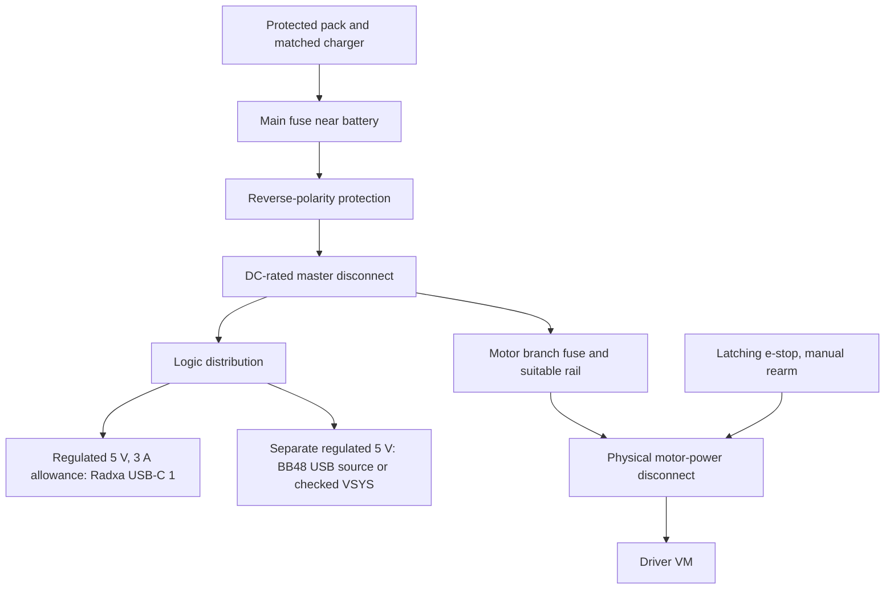

# Power plan

**Planned and untested. No hardware milestone has passed.** Updated for the
base Olimex RP2350-PICO2-BB48 on 13 October 2026. Radxa ZERO 3W stays the
computer. Prices retained below are historical planning estimates from
11 October, not refreshed shopping quotes. No assembled load is measured.

For P1 I want computer USB for BB48, a checked spare 5 V supply for Radxa
USB-C 1, and motor batteries disconnected until milestone 2. The separate
AA NiMH motor supply comes later. Shared-pack power is a later design.

## BB48 USB and external power

The [Rev A schematic][bb48-schematic] shows USB-C VBUS through D1 to VSYS,
then the 3.3 V regulator. There is no host-controlled target-power gate.
That supports trying a plain bank on its own USB-C lead without requiring
Radxa enumeration to turn the target on. It does **not** prove reliable
startup, low-current stay-on, cable behaviour or total board current.

Olimex describes VBUS as USB 5 V and VSYS as a possible external 5 V input,
with **USB disconnected when VSYS is used as an input**. Its regulator/output
ratings aren't measured spare capacity with our sensors. For P1 use one USB
source at a time. A later regulated 5 V/VSYS branch needs revision, voltage,
polarity and protection checks; never feed a raw battery into VSYS.
[Olimex manual, power supply page][bb48-manual]

BB48 USB `Serial` is native USB, with the ROM uploader on the same connector.
Upload/reset/unplug may remove or change its running serial device. There is
no separate debugger bridge assumed to survive reset. The initial counter
is diagnostic text only; future T/D/STOP USB transport is not implemented.
[Arduino-Pico serial][bb48-serial], [counter](../firmware/src/main.cpp)

Keep Radxa header pins **2/4 disconnected** from BB48. Measuring 5 V alone
doesn't establish external current or protection. The current plan uses a
separate USB lead and shared ground. [Wiring plan](../hardware/wiring.md)

## Will a power bank stay on?

Low-current loads can be below a bank's detection threshold. Anker gives
generic examples, not a universal threshold. BB48 alone may need a bank with
a suitable low-load mode. Actual BB48/bank operation is unverified.
[Anker explanation][anker-mode]

Voltaic advertises always-on USB-A outputs for V25/V50/V75. The retained UK
V25 example was £59.99, 5 V/2 A per output and 3 A combined, delivery unknown.
That doesn't provide a single 3 A Radxa output. Anker's cited PowerCore
Essential mode ends after two hours, so it isn't indefinitely always-on.
[Voltaic][voltaic], [UK example][v25-uk], [Anker instructions][anker-uk]

Radxa's preparation guide says at least 5 V/2 A; FAQ says at least 15 W,
equivalent to 3 A at 5 V. I retain a **5 V/3 A Radxa branch planning allowance**,
not a claim of constant draw or capacity for every accessory. Test each bank
output separately and together, at lowest load and on recovery. Radxa keeping
a bank awake, including the BB48's separate output, is unverified.
[Preparation][radxa-power], [FAQ][radxa-faq]

## My proposed USB host fix

My earlier idea was to power the controller from Radxa's USB host and use a
hub for the C920. With base BB48's documented power path, that is now an
**optional bench arrangement**, not a fix needed to enable controller power.
I haven't tested it. My first choice for P1 is separate BB48 USB power and
UART data, leaving USB-C 2 for C920.

| Radxa port | Documented role | Open check |
| --- | --- | --- |
| USB-C 1 | 5 V input and USB 2.0 OTG | Host data while receiving power needs a checked splitter/OS; not assumed |
| USB-C 2 | USB 3.0 host | C920 and optional hub/controller enumeration, current and capture stability |

[Radxa interface][radxa-usb]

The product brief publishes a **500 mA host-port budget**. Keep that limit
for camera+hub+BB48 combined if bus-powered. V1.12 U11/R70 with SY6280 and
4.7 kΩ gives `6800 / 4700`, about **1.45 A nominal current-limit threshold**.
It is a protection calculation, not a usable downstream-current rating.
A stronger bank doesn't increase the host port's published allowance.
[Product brief][radxa-brief], [schematic][radxa-schematic], [Silergy][sy6280]

The BB48 build definition sets `USBD_MAX_POWER_MA=500`. Inspect the actual
device descriptor on arrival; a build flag isn't a measured current or proof
of what the installed host accepts. Linux can reject a configuration whose
declared power exceeds the bus budget. Low measured current doesn't alone
make a bus-powered hub arrangement valid. [BB48 definition][bb48-board],
[Linux USB configuration code][linux-budget]

### Optional ways to attach both devices

All routes below are planned and untested. Historical UK examples retain
their 11 October prices; exact delivered cost and present stock are unknown.

| Route | How it would work | Main checks | Historical example |
| --- | --- | --- | --- |
| Bus-powered hub on USB-C 2 | C920 and BB48 each use a hub data port | Combined measured/declared current within 500 mA; startup, capture and enumeration | UH400 £8.99; delivery/local stock not shown. [Offer][hub-bus] |
| Externally powered hub | Hub supplies both devices; upstream data to Radxa | Correct hub supply, no upstream back-feed, no dual BB48 supply, sustained capture | UH700 £28.74 inc VAT calculated from £23.95 ex VAT; delivery unknown. [Offer][hub-powered] |
| USB-C 1 host/power splitter | One source powers Radxa while data port serves BB48 | CC signalling, host configuration, isolation and boot order unverified | Innov8 £4.95 inc VAT plus £1.75 listed delivery; old stock note was re-stocking. [Offer][otg-offer] |
| Separate BB48 bank USB lead plus UART | No hub needed for controller; camera retains USB-C 2 | Own output stay-on, ground, UART levels/overlay and host-reset timeout | Existing planned cables; no extra price established |

UH700's sheet lists Linux support, a 12 V/2 A adapter and 165 x 65.5 x 17.5 mm
body. It isn't a small hub that can simply take the 5 V rail. Upstream
isolation isn't established. UH400's cited version is 71 x 71 x 16.6 mm with
USB-A input/outputs and no separate supply listed; verify supplied revision.
These are maker dimensions, not a rover fit test. [UH700][hub-data],
[UH400][hub-bus-data], [maker][hub-bus-maker]

Radxa forum reports show some OTG splitter successes/failures on older
images, not verification of our setup. A report of exact ZERO 3W+C920+BB48
operation was not found. Mount any hub securely and strain-relieve leads so
adapters don't carry cable weight at the board socket. [Forum][otg-report]

### Linux serial and reboot behaviour

Native USB serial is expected to use Linux CDC ACM and `/dev/ttyACM*`.
Any `/dev/serial/by-id/` link depends on a reported identity and installed
udev rules. Both are **unconfirmed until inspected**, not a default config.
USB reset/unplug may re-enumerate and change the numbered path. A stable
name doesn't preserve an open handle. ROM BOOTSEL storage is for upload,
not the telemetry folder. [Core USB][bb48-serial], [Linux ACM][linux-acm],
[udev rules][serial-rules]

The logger stops on serial errors without silently reconnecting. A UART run
with regressing/repeated time or encoder counts splits according to the
existing contract. Native USB reset can instead disconnect and stop a run.
Later firmware/recovery behaviour needs testing. [Recorder](../pi/recorder.py)

### Current budget and data link

No real current figures exist. For same-5 V bus-powered loads, my estimate is
`I_bank = I_Radxa_alone + I_hub + I_C920 + I_BB48_with_sensors`.
If the meter on USB-C 1 already includes downstream loads, don't add them
again. Separate BB48 or powered-hub outputs need separate measurements.
Descriptors aren't current measurements and slow meters can miss peaks.

| Link | Planned use | Failure/timing checks |
| --- | --- | --- |
| Native USB `Serial` | P1 computer counter, later PC protocol; optional Radxa hub experiment | Enumeration, shared power and port loss; end-to-end delay unmeasured |
| UART0 GPIO0/1 to Radxa UART3-M0 | Planned rover link with separate controller power | Crossed 3.3 V pins, common ground, actual device/overlay and local timeout |

At 115200 8N1, a maximum 256-byte line takes about **22.2 ms** to transmit.
That is a calculation, not measured latency. Keep the later 100 Hz control
loop on BB48. T/D/STOP, fields and schema are unchanged. [Contract](data_contract.md)

### Motor-off defaults and noise

A Radxa reboot doesn't guarantee BB48 loses power or receives STOP. TB6612
has internal 200 kΩ pull-downs; STBY low disables outputs in standby, not
active braking. Its valid logic-supply limits still apply. [Toshiba][tb6612]

Plan seven external 4.7 kΩ driver pull-downs, ±5% or better. At +5%, the
highest resistance is 4.935 kΩ, about 40% below E9's 8.2 kΩ limit. The value
is a proposal until measured; all wiring remains planned and untested.
Confirm A2/A4 silicon and measure every driver input at power-up, reset,
BOOT and USB disconnect with VM disconnected. E9 doesn't affect pull-downs
immediately after power-on or RUN reset while input-enable is clear; later
pin configuration still needs checking. A4 is unaffected by E9, but reset
checks remain. Revise the circuit before VM if low isn't assured. Current
counter firmware has no motor control, timeout or rearm. Later code and a separate physical
motor-power e-stop need their own tests. [RP2350 errata][rp2350],
[A4 announcement][a4], [pin plan](../hardware/wiring.md)

Keep motor supply and return separate from thin signal/USB paths, with shared
ground at distribution. Motor suppression, short twisted leads and decoupling
need checking on the selected hardware. Plan 100 nF at the soil ADC and
compare reference/readings with motors off/on at milestone 5. Capacitors
don't prove noise immunity. [Pololu motor-noise guidance][motor-noise]

## How power could progress

| Stage | Proposed arrangement | Checks still pending |
| --- | --- | --- |
| P1 bench | BB48 computer USB, Radxa checked spare 5 V source, motors disconnected until milestone 2 | USB upload/counter, current, silicon/reference and reset defaults |
| P1 mobile | Separate AA motors, checked bank outputs for Radxa and BB48; UART | Per-output load/stay-on, cable drop, motor transients and timeout |
| P2 | One ready-made protected battery, separate regulated logic/motor branches | Average/start/peak currents, voltage range, fuses and connectors |
| P3 | Add an actuator branch after selecting probe/hatch mechanisms | Start/stall current, heat, voltage dips and stops |
| Final product proposal | Protected pack, matched charger, monitored shutdown and physical motor isolation | Charge-temperature limits, recovery, environmental tests and design review |

This is a design proposal, not ready wiring. Grounds join at distribution;
high motor current must not flow through a breadboard or UART ground lead.
Select fuses against wiring/pack/startup ratings, not just normal current.
[Fuse guidance][fuse-guide]

The e-stop should physically cut motor VM while logic records the stop.
A DC-rated relay/contactor with a normally closed control loop and deliberate
rearm is a candidate, not an approved circuit. The cited switch's rating
doesn't establish its inductive motor rating. Do not use the electronic
Pololu pushbutton switch as an e-stop; its maker warns against that use.
[Switch specification][stop-switch], [Pololu guidance][switch-guidance]

Use a proper regulated 5 V USB source interface for each USB-powered board,
not loose battery wires into a USB-C plug. External VSYS on BB48 must instead
follow the manual with USB unplugged. Header power/current and USB-C source
compatibility remain unverified. [Olimex][bb48-manual], [Radxa][radxa-power]

## Battery options and cold weather

Prefer a complete pack with documented protection, discharge ratings and a
matched charger over assembling bare lithium cells. A product labelled
protected still needs its exact limits checked. I have not verified a small
UK pack with all of the proposed final-product requirements.

| Candidate | Cost seen, an estimate for planning | Useful evidence and limits |
| --- | --- | --- |
| Tracer BP2541, enclosed lithium-polymer pack with charger | £99 ex VAT; **£118.80 inc VAT calculated at 20%**, delivery not shown | Website calls it 12 V/4 Ah/48 Wh. Data sheet gives actual 11.1 V, 12.6 V full, 8.25 V cutoff, 4 A continuous, 20 A for **10 ms only**. Charge 0-45°C, discharge -10-60°C. Full protection functions and recovery thresholds still need confirmation. [UK maker][tracer], [data sheet][tracer-data] |
| Talentcell LF4100 LiFePO4 pack | **£65.99** on Amazon UK; free delivery shown | Seller claims overcharge, overdischarge and short-circuit protection. Direct output is 14.6-9 V, up to 5 A; its USB output is only 5 V/2 A. Manufacturer lists operation at **0-60°C**, so below-zero use is not established. [UK listing][talent-uk], [maker][talent] |
| Overlander 7.2 V/2 Ah NiMH pack | **£14.99**, delivery and explicit VAT status not shown | Ready-made six-cell pack with Tamiya connector; matching NiMH charger costs extra. Protection/cutoff, cold limits and discharge-current rating were not shown. Do not assume it has a BMS. [UK maker][nimh] |

The Talentcell pages conflict: the manufacturer shows 6500 mAh with 76.8 Wh,
while the Amazon title says 6000 mAh. The listing describes both a 14.4 V
charger and a 12.6 V charger in different sections and carries a frequently
returned notice. **I would not order it until the exact charger and protection
details are clarified.** [Maker][talent], [UK listing][talent-uk]

LiFePO4 is not automatically a cold-weather answer. Charging and discharging
have different temperature limits. For example, Victron's Lithium NG system
requires its BMS to stop charging below 5°C; that threshold is specific to
that system. It is not evidence of temperature protection inside the LF4100.
A small cold-rated pack with verified low-temperature charge cutoff was
**not found** in this research. [Victron BMS guidance][cold-guide]

For the first bench build, NiMH keeps the proposed motor supply separate and
avoids having to design a lithium pack. Later lithium candidates offer more
stored energy in these particular examples, at a higher price. None of the
listings proves suitability for our motor starts or stalls. Do not connect
their raw pack voltage to the 5 V boards or the planned low-voltage motors.
[P1 parts plan](../hardware/parts.md), [pack data][tracer-data], [LF4100 output][talent]

### The runtime calculation

This is my planning calculation, not a runtime result. Energy is voltage
times charge capacity: `Wh = V * Ah`. A supply capable of 5 V/3 A can provide
15 W, but that does not mean the Radxa constantly uses 15 W.

For each branch, estimate battery power as `rail voltage * average current /
regulator efficiency`, then add the branches. If the Radxa input measurement
already includes the C920, do not add the camera again. Runtime in hours is
`usable battery Wh / average battery W`.

For a **SIMULATED planning example with an invented 15 W average load** and
an **assumed 80% usable-energy factor including conversion losses**:

| Example energy | Calculation | Illustrative time only |
| --- | --- | --- |
| NiMH: 7.2 V * 2 Ah = 14.4 Wh | 14.4 * 0.8 / 15 | About 46 minutes |
| Tracer: actual 11.1 V * 4 Ah = 44.4 Wh | 44.4 * 0.8 / 15 | About 2 hours 22 minutes |
| LF4100: 12.8 V * 6 Ah = 76.8 Wh | 76.8 * 0.8 / 15 | About 4 hours 6 minutes |

Those nominal inputs come from [Overlander][nimh], [Tracer's data sheet][tracer-data]
and the [LF4100 listing][talent-uk]. Temperature, load, ageing and cutoff can
change usable energy. The examples do not validate a battery's peak-current
ability. That must be checked separately against its published rating.

## UK parts shortlist

**Planning estimates, not a shopping instruction or a delivered total.**
Prices were visible on 11 October 2026 and can change. Delivery was not shown
unless stated above. These are candidates, not verified rover parts. Regulator
boards also need secure connections and any required soldering.

| Item | Price seen | Why it is here, and what remains open | Source |
| --- | --- | --- | --- |
| Bench supplies | Use checked spares or borrow a current-limited supply; new purchase not priced | BB48 PC USB first. Radxa 5 V; preparation says at least 2 A, FAQ recommends 15 W, equivalent to 3 A. Check the actual spare's label | [Preparation][radxa-power], [FAQ][radxa-faq] |
| Radxa 5 V regulator: Pololu D30V30F5 | **£28.80 inc VAT** | Nominal 5 V, typically 3.4 A; ±4% output. Rating depends on input and cooling, so it needs checking at our battery range | [UK offer][radxa-buck-uk], [maker][radxa-buck] |
| BB48 5 V regulator: Pololu D24V10F5 | **£12.50 inc VAT** | Nominal 5 V/1 A, ±4%. **No reverse-voltage protection.** A regulator rating is not a measured BB48 load; use a protected USB source or separately checked VSYS input | [UK offer][controller-buck-uk], [maker][controller-buck] |
| Motor regulator candidate: Pololu D30V30F6 | **£29.80 inc VAT** in the UK catalogue | A 6 V option only if the selected motors support it and measured starts/stalls fit its rating. Otherwise select a different rail and driver | [UK catalogue][buck-catalogue] |
| Reverse protection: Pololu 5387 | **£7.70 inc VAT** | 4-60 V module, listed up to 25 A. It permits reverse current; it is not a BMS, fuse or e-stop | [UK specification][reverse-uk] |
| Inline standard blade fuse holder | **£1.24 inc VAT each** | Listed 32 V DC/20 A holder. Fit a separately selected fuse, not automatically 20 A | [UK specification][fuse-holder] |
| Latching NC stop-switch candidate, SCI R13-930LS-01-1 | **£6.40 inc VAT** | Seller lists 21 A at 14 V DC and 12 V illumination. **Not approved for direct raw LF4100 power: full pack voltage can exceed 14 V.** Inductive rating not verified | [UK specification][stop-switch] |
| Main fuse, branch fuses, master disconnect, motor relay/contactor, USB source interface and power wiring | Exact parts and prices **not found/selected** | Choose after measuring loads. Require DC ratings, correct wire/connector capacity and a tested rearm circuit | [Fuse selection basis][fuse-guide], [switch limitations][switch-guidance] |
| USB current meter and multimeter | Borrow first; exact current UK offers not verified | Need suitable range, connectors, resolution and a stated method for recording peaks | [Measurement plan below](#milestone-0-measurements) |

The Radxa regulator's 3.4 A figure is typical at 30 V input, not a guaranteed
3 A at every battery voltage. Pololu publishes load/temperature curves and
dropout behaviour. Check it at the lowest battery voltage and inside the
planned housing. The BB48 regulator also needs enough input headroom;
neither is a boost converter. [D30V30F5][radxa-buck], [D24V10F5][controller-buck]

These examples would add a noticeable cost. The battery options above are
alternatives, not three items to buy together. A complete-system total cannot
be given yet because the motor loads, charger, wiring, interface and disconnect
parts are not all selected.

## Milestone 0 measurements

Record values as **not measured** until hardware tests happen. Record the
instrument, supply, cable, board revision and activity alongside every value.
The table is a proposed test plan based on the boards' stated input routes
and the load-dependent regulator ratings. [Radxa][radxa-power],
[Olimex schematic][bb48-schematic], [regulator curves][radxa-buck]

| Measurement | Proposed check | How it affects the design |
| --- | --- | --- |
| Radxa input alone | Boot peak, settled idle with Wi-Fi, and a CPU/network workload; voltage at USB-C 1 as well as source current | 5 V branch capacity, cable drop and baseline energy use |
| Radxa with C920 | Repeat while capturing photos and transferring files; include first-boot keyboard separately | Whole logic-branch peak and average; avoid double-counting the camera |
| C920 by itself | Compatible inline USB meter between host adapter and camera; capture startup and sustained capture current | Host-port load. A slow meter's maximum is not a guaranteed transient peak |
| BB48 whole-board input | First run the counter on PC USB. Later compare its own bank USB-C lead or separately checked VSYS input | Board plus sensor consumption, bank low-load risk and branch budget |
| BB48 USB/VSYS rail | Confirm base board/revision and one supply with power off, then measure voltage and polarity | Establish the real source path before any external input test |
| Power bank | Each output alone and both together; run at the lowest intended load for longer than any timed low-current mode; check restart and shutdown recovery | Whether it actually stays on and whether outputs interfere |
| Motors | At milestone 0, collect voltage/current ratings and leave missing figures unknown. **Powered tests wait for milestone 2**: each motor unloaded and under controlled load, then both starting together | Motor regulator, driver, pack peak current and fuse curve |
| Temperature and voltage dips | Later repeat the loaded test inside the proposed housing, at minimum battery voltage; use a suitable fast instrument for brief dips | Thermal margin and reset/dropout risk |

Motor stall current is still unknown. Do not hold a wheel locked to make a
measurement during setup. Obtain the motor's data first; any later brief
stall test needs a current-limited supply and a separate procedure. The pack's
10 ms peak rating cannot be treated as continuous stall capacity. [Tracer
rating][tracer-data], [fuse startup considerations][fuse-guide]

For current measurements, use an inline instrument or place the ammeter
in series using its correct fused input and range. Do not put an ammeter
across the supply. Confirm the actual meter's instructions first; its model
and transient capture ability have not been selected.

## Still to check on the real build

- Delivered base BB48, headers, PCB revision and A2/A4 silicon. Board revision is not chip stepping.
- BB48 current, USB/bank startup and the one-source USB/VSYS rule.
- ADC reference/output limits and repeatability with motors off/on.
- STBY/PWM/direction logic low at power-up/reset/BOOT/disconnect with VM disconnected; seven proposed 4.7 kΩ pull-downs, ±5% or better, untested until measured. Keep the A2/A4 check and confirm resistor tolerance against the E9 limit.
- Crossed UART0 to Radxa UART3-M0 and reset/disconnect run handling.
- Radxa boot/peak current, USB-C source compatibility, cable voltage drop and C920 behaviour.
- Bank low-load shutoff, mode timeout and interaction between outputs.
- Actual motors' voltage, starting/stall currents and motor-driver limits.
- Pack protection functions, discharge rating, matched charger and temperature cutoffs. The budget LiFePO4 candidate is not cleared for purchase.
- Regulator performance at minimum battery voltage, motor transients and heat in the enclosure.
- DC-rated master disconnect and motor stop circuit, including a deliberate rearm and no automatic motion after recovery.
- Battery mounting, connectors and enclosure protection. None of this research establishes a waterproof rover or a product safety approval.

The next hardware step stays **milestone 0/1 on the bench**, one result at a
time. Shared-pack wiring comes after these measurements, not before them.

[radxa-power]: https://docs.radxa.com/en/zero/zero3/getting-started/preparation
[anker-mode]: https://service.anker.com/article-description/What-is-Trickle-Charging-Mode?ref=Home_Page
[anker-uk]: https://service.anker.com/uk/article-description/How-to-activate-trickle-charging-mode-for-Anker-PowerCore-Essential-20000
[voltaic]: https://voltaicsystems.com/always-on-batteries/
[v25-uk]: https://www.funkyleisure.co.uk/voltaic-systems-v25-usb-battery-pack-12546-p.asp
[tracer]: https://tracerpower.com/products/batteries/tracer-12v-4ah-lithium-polymer-battery-pack/
[tracer-data]: https://b000c40e88d795270553.b-cdn.net/wp-content/uploads/2025/07/BP2541-Data-Sheet-A5.pdf
[talent]: https://talentcell.com/lifepo4-battery/12v-6ah/lf4100.html
[talent-uk]: https://www.amazon.co.uk/TalentCell-LiFePO4-LF4100-Rechargeable-Phosphate/dp/B0CGMTDC5Y
[nimh]: https://overlander.co.uk/product/subc-2000mah-7-2v-premium-sport-nimh-battery/
[cold-guide]: https://www.victronenergy.com/media/pg/Lithium_NG_battery_12,8_V/en/system-design-and-bms-selection-guide.html
[radxa-buck-uk]: https://thepihut.com/products/pololu-5v-3-4a-step-down-voltage-regulator-d30v30f5
[radxa-buck]: https://www.pololu.com/product/4892
[controller-buck-uk]: https://thepihut.com/products/pololu-5v-1a-step-down-voltage-regulator-d24v10f5
[controller-buck]: https://www.pololu.com/product/2831
[buck-catalogue]: https://thepihut.com/collections/voltage-regulators-buck-converters/brand_pololu
[reverse-uk]: https://thepihut.com/products/pololu-reverse-voltage-protector-4-60v-25a
[fuse-holder]: https://www.switchelectronics.co.uk/products/standard-blade-in-line-fuse-holder-20a
[stop-switch]: https://www.switchelectronics.co.uk/products/red-illuminated-emergency-stop-switch-12v-r13-930ls-01-1
[switch-guidance]: https://www.pololu.com/product/2808
[fuse-guide]: https://www.littelfuse.com/assetdocs/fuseology-fuse-facts-and-fuse-selection-guide?assetguid=be92b28c-1f63-4f48-a505-55c582b7c1ae
[radxa-usb]: https://docs.radxa.com/en/zero/zero3/hardware-design/hardware-interface
[radxa-faq]: https://docs.radxa.com/en/zero/zero3/faq
[radxa-brief]: https://dl.radxa.com/zero3/docs/hw/3w/radxa_zero_3w_product_brief.pdf
[radxa-schematic]: https://dl.radxa.com/zero3/docs/hw/3w/radxa_zero_3w_v1.12_schematic.pdf
[sy6280]: https://www.silergy.com/zh/download/downloadFile?id=4369&type=product&ftype=note
[linux-budget]: https://github.com/torvalds/linux/blob/master/drivers/usb/core/generic.c
[hub-bus]: https://www.argos.co.uk/product/8519294
[hub-powered]: https://cpc.farnell.com/tp-link/uh700/hub-usb-3-0-7-port/dp/CS38610
[hub-data]: https://www.farnell.com/datasheets/4550049.pdf
[hub-bus-data]: https://static.tp-link.com/TL-UH400(UN)%202.0_datasheet.pdf
[hub-bus-maker]: https://www.tp-link.com/uk/home-networking/computer-accessory/uh400/
[otg-offer]: https://www.innov8wholesale.com/products/usb-c-male-to-usb-a-and-usb-c-female-otg-splitter-adapter-20gbps-v2
[otg-report]: https://forum.radxa.com/t/overlay-otg-host-mode-not-working-on-zero-3w/24124
[linux-acm]: https://docs.kernel.org/usb/acm.html
[serial-rules]: https://github.com/systemd/systemd/blob/main/rules.d/60-serial.rules
[tb6612]: https://toshiba.semicon-storage.com/info/docget.jsp?did=10660&prodName=TB6612FNG
[motor-noise]: https://www.pololu.com/docs/0J15/9

[bb48-manual]: https://github.com/OLIMEX/RP2350-PICO2-BB48/blob/main/DOCUMENTS/RP2350-PICO2-BB48-user-manual.pdf
[bb48-schematic]: https://github.com/OLIMEX/RP2350-PICO2-BB48/blob/main/HARDWARE/RP2350-PICO2-BB48.REV.A/PICO2-BB48_Rev_A.pdf
[bb48-serial]: https://arduino-pico.readthedocs.io/en/latest/serial.html
[bb48-board]: https://github.com/maxgerhardt/platform-raspberrypi/blob/develop/boards/olimex_pico2bb48.json
[rp2350]: https://pip-assets.raspberrypi.com/categories/1214-rp2350/documents/RP-008373-DS-2-rp2350-datasheet.pdf
[a4]: https://www.raspberrypi.com/news/rp2350-a4-rp2354-and-a-new-hacking-challenge/
