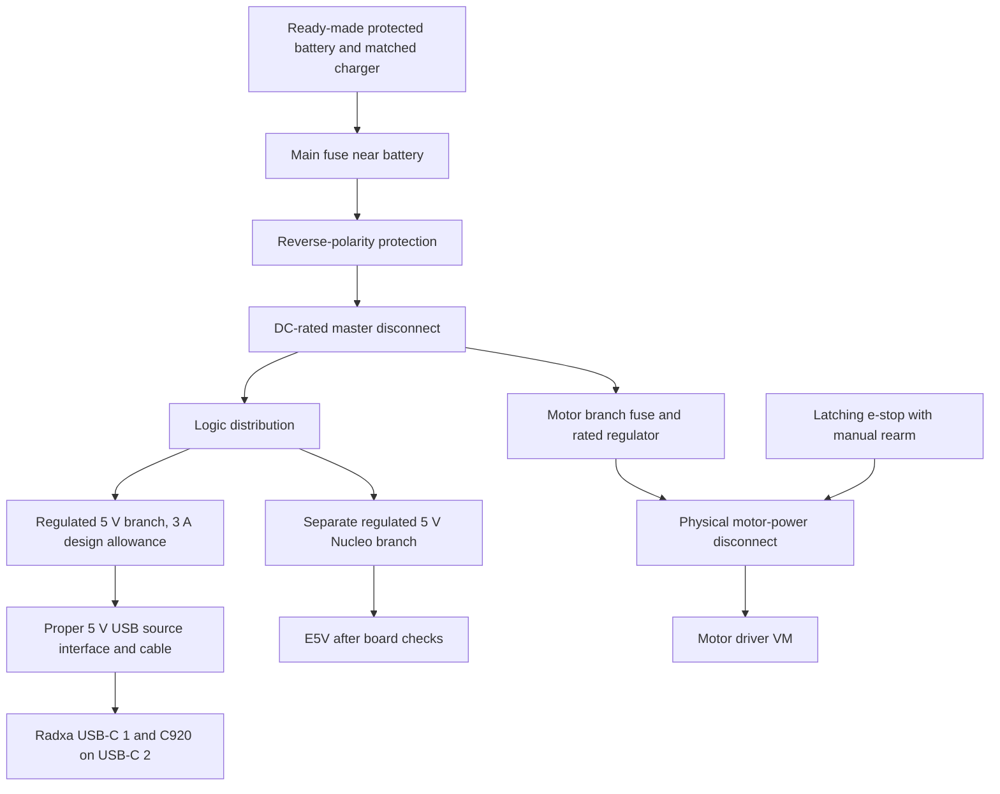

# Power plan

**Planned and untested.** This is research for the NUCLEO-G474RE and Radxa
ZERO 3W, checked on 11 October 2026. None of these power arrangements has
been tested on the boards. No hardware milestone has passed. This does not
change the [wiring plan](../hardware/wiring.md).

I want to measure the first build before buying a bigger battery. For P1 on
the bench, the proposed starting point is computer USB for the Nucleo and
a suitable spare supply for the Radxa. Motor power comes later, at the motor
milestone. The shared battery below is a later design proposal.

## The Nucleo power selector

The researched schematic is **MB1367-G474RE D01**, dated 26 September 2025.
Its JP5 selects which source feeds the board's 5 V rail. Check the revision
printed on the delivered board before using this table. [ST schematic, sheets
6 and 7][st-schematic]

| JP5 pins | Source | What the schematic shows |
| --- | --- | --- |
| 1-2, default | `5V_USB_STLK` | CN1 USB power through U4, the ST-LINK-controlled switch |
| 3-4 | `5V_VIN` | VIN through U11, the 5 V linear regulator |
| 5-6 | `E5V` | External regulated 5 V directly into the selected rail |
| 7-8 | `5V_USB_CHGR` | CN1 USB power before U4, bypassing that switch |

The default path needs successful USB enumeration before ST-LINK enables
target power. A power bank with no USB host cannot be relied on in that mode.
The charger position is the documented non-host alternative. [ST manual,
sections 6.4.1 and 6.4.4][st-manual]

| Other input detail | Published value | Source |
| --- | --- | --- |
| VIN | CN6 pin 8 or CN7 pin 24; 7-12 V. Current allowance falls from 800 mA at 7 V to 250 mA at the upper range | [ST manual, table 6][st-manual] |
| E5V | CN7 pin 6; 4.75-5.25 V, 500 mA | [ST manual, table 7][st-manual] |
| USB charger | CN1, 5 V; table leaves maximum current unstated | [ST manual, table 8][st-manual] |
| External 3.3 V | CN6 pin 4 or CN7 pin 16; 3-3.6 V, 1.3 A. ST-LINK is unavailable in this mode | [ST manual, section 6.4.5][st-manual] |

The VIN and charger paragraphs say **JP2**, while table 4 and the schematic
say **JP5**. USB budgeting also differs: the manual mentions 500 mA overall
but warns above 300 mA. Use the conservative limit pending clarification.
[ST manual, sections 6.4.1-6.4.4][st-manual]

The circuit explanation matters here. U4 is an STMPS2151STR between
`5V_USB_CHGR` and `5V_USB_STLK`, with `T_PWR_EN` controlling it. My inference
is that selecting the charger rail removes both the enumeration dependency
and U4's protection from the target's supply path. It does not turn an
unprotected source into a protected supply. [ST schematic, sheet 7][st-schematic]

For a later regulated 5 V rover branch, **E5V is my preferred proposal**:
JP5 5-6, E5V on CN7 pin 6 and ground on CN7 pin 8. Confirm the delivered
revision, polarity and voltage first. Do not put 5 V into VIN or feed a
battery directly into E5V. Use an externally protected branch. [ST schematic,
sheet 6][st-schematic]

Do not move jumpers now. For P1's counter test, keep the documented default
and connect only computer USB. Any later charger/E5V test needs its own
board-revision check. External power plus a computer debug cable is a separate
documented procedure, not permission to connect arbitrary supplies together.
[Existing counter instructions](software_prep.md#milestone-1-when-the-nucleo-arrives)

## Will a power bank stay on?

Anker explains that low-current devices can fall below a bank's detection
threshold. Its generic examples are 30-90 mA, not a universal threshold.
That makes Nucleo-only operation a possible problem, but the actual Nucleo
and bank combination has not been measured. [Anker low-current explanation][anker-mode]

Always-on banks do exist. Voltaic says its V25, V50 and V75 USB-A outputs
can stay on at low current. This still depends on charge remaining and the
pack's protection limits. A UK V25 listing was £59.99, with 5 V/2 A per
USB-A output and 3 A combined. It does **not** give one USB-A port the proposed
Radxa 3 A allowance. Delivery cost was not shown. [Voltaic][voltaic],
[UK listing][v25-uk]

Anker's UK instructions for PowerCore Essential 20000 describe a trickle
mode enabled by pressing the button twice, but it ends after two hours.
That is a timed low-current mode, not an indefinitely always-on supply.
A current UK offer for that exact model was not verified. [Anker UK instructions][anker-uk]

Radxa states 5 V input through **USB-C 1**, recommends at least 5 V/2 A and
recommends its PD30W adapter. No measured ZERO 3W idle/peak current or
guarantee that an arbitrary bank stays on was found there. The proposed
**5 V/3 A branch is a design allowance**, not a measured draw or a new Radxa
requirement. [Radxa preparation guide][radxa-power]

My proposed bank check is to test each output separately and together,
including the lowest-load state and recovery after shutdown. A running Radxa
may keep a shared bank active, but I have not verified whether a chosen bank
detects load per output. Do not assume it does. This check follows the
low-current behaviour described by [Anker][anker-mode].

## How power could progress

These are proposals within the existing [prototype roadmap](prototype_roadmap.md).
They are not new passed milestones or a reason to buy every item now.

| Stage | Proposed arrangement | What has to be checked first |
| --- | --- | --- |
| P1, bench | Nucleo on computer USB. Radxa on a verified spare 5 V supply through USB-C 1. Motors disconnected until milestone 2; then the planned separate AA NiMH motor pack | Supply labels, cables, stable boot, actual currents and default Nucleo jumpers |
| P1, supervised mobile tests | Separate motor pack and a tested USB bank for logic. Nucleo USB-charger selection only after revision checks | Enumeration-independent start and low-load bank behaviour |
| P2 | Investigate one ready-made protected battery with separate regulated logic and motor branches | Recorded average/peak currents, battery voltage range, fuse and connector ratings |
| P3 | Keep that split, then size an additional actuator branch if the probe mechanism is selected | Actuator start/stall current, voltage dips, heat inside the housing and stop behaviour |
| Final product proposal | A rated protected pack, matched charger, monitored low-battery shutdown and physical motor isolation | Charge-temperature protection, recovery behaviour, environmental tests and a full design review |

The first two rows follow the proposed source routes above and the existing
[P1 parts plan](../hardware/parts.md). The later rows are my design decisions,
based on the input limits in [Radxa's guide][radxa-power], the
[ST schematic][st-schematic] and the component limits below.

### Proposed single-pack layout

This diagram is planned, not wiring instructions. Grounds join at a suitable
distribution point. Give motor current its own return path rather than sending
it through thin logic jumpers. Keep high-current power out of the breadboard.
The proposed layout keeps the input sources separate and follows the boards'
supply routes. [ST schematic][st-schematic], [Radxa guide][radxa-power]

I would use a fuse close to the battery and branch protection sized to the
wires, connectors and loads. The fuse must have a suitable DC voltage and
fault-current rating. Its time/current curve must tolerate normal startup
without leaving a fault unprotected. A holder marked 20 A does not mean we
should fit a 20 A fuse. Exact values remain unselected. [Littelfuse selection
guide][fuse-guide], [holder specification][fuse-holder]

The **e-stop should physically remove motor-driver VM**, while the logic
stays powered to record the stop. A normally closed control loop operating
a normally open, DC-rated relay/contactor is a candidate. It must have a
manual rearm, so releasing the button alone cannot resume motion. Direct
switching is only an option with verified DC motor-load ratings. These are
design requirements, not a finished safety circuit. The candidate switch's
published rating does not establish its inductive motor rating. [Switch
specification][stop-switch]

Do not use the Pololu electronic pushbutton switch as the e-stop; the maker
explicitly warns against that use. Motor switching can also create voltage
spikes. Transient suppression and bulk capacitance need selecting for the
actual motor supply and disconnect arrangement, then testing. [Pololu power
switch guidance][switch-guidance]

The proposed Radxa branch needs a proper 5 V USB power-source interface,
including the connector's signalling requirements, not just a loose USB-C
plug with battery wires attached. The exact interface and USB-C-to-USB-C
behaviour remain unverified. Do not power the Nucleo from Radxa header pins
2/4. Keep that existing restriction in the [wiring plan](../hardware/wiring.md).

## Battery options and cold weather

Prefer a complete pack with documented protection, discharge ratings and a
matched charger over assembling bare lithium cells. A product labelled
protected still needs its exact limits checked. I have not verified a small
UK pack with all of the proposed final-product requirements.

| Candidate | Cost seen, an estimate for planning | Useful evidence and limits |
| --- | --- | --- |
| Tracer BP2541, enclosed lithium-polymer pack with charger | £99 ex VAT; **£118.80 inc VAT calculated at 20%**, delivery not shown | Website calls it 12 V/4 Ah/48 Wh. Data sheet gives actual 11.1 V, 12.6 V full, 8.25 V cutoff, 4 A continuous, 20 A for **10 ms only**. Charge 0-45°C, discharge -10-60°C. Full protection functions and recovery thresholds still need confirmation. [UK maker][tracer], [data sheet][tracer-data] |
| Talentcell LF4100 LiFePO4 pack | **£65.99** on Amazon UK; free delivery shown | Seller claims overcharge, overdischarge and short-circuit protection. Direct output is 14.6-9 V, up to 5 A; its USB output is only 5 V/2 A. Manufacturer lists operation at **0-60°C**, so below-zero use is not established. [UK listing][talent-uk], [maker][talent] |
| Overlander 7.2 V/2 Ah NiMH pack | **£14.99**, delivery and explicit VAT status not shown | Ready-made six-cell pack with Tamiya connector; matching NiMH charger costs extra. Protection/cutoff, cold limits and discharge-current rating were not shown. Do not assume it has a BMS. [UK maker][nimh] |

The Talentcell pages conflict: the manufacturer shows 6500 mAh with 76.8 Wh,
while the Amazon title says 6000 mAh. The listing describes both a 14.4 V
charger and a 12.6 V charger in different sections and carries a frequently
returned notice. **I would not order it until the exact charger and protection
details are clarified.** [Maker][talent], [UK listing][talent-uk]

LiFePO4 is not automatically a cold-weather answer. Charging and discharging
have different temperature limits. For example, Victron's Lithium NG system
requires its BMS to stop charging below 5°C; that threshold is specific to
that system. It is not evidence of temperature protection inside the LF4100.
A small cold-rated pack with verified low-temperature charge cutoff was
**not found** in this research. [Victron BMS guidance][cold-guide]

For the first bench build, NiMH keeps the proposed motor supply separate and
avoids having to design a lithium pack. Later lithium candidates offer more
stored energy in these particular examples, at a higher price. None of the
listings proves suitability for our motor starts or stalls. Do not connect
their raw pack voltage to the 5 V boards or the planned low-voltage motors.
[P1 parts plan](../hardware/parts.md), [pack data][tracer-data], [LF4100 output][talent]

### The runtime calculation

This is my planning calculation, not a runtime result. Energy is voltage
times charge capacity: `Wh = V * Ah`. A supply capable of 5 V/3 A can provide
15 W, but that does not mean the Radxa constantly uses 15 W.

For each branch, estimate battery power as `rail voltage * average current /
regulator efficiency`, then add the branches. If the Radxa input measurement
already includes the C920, do not add the camera again. Runtime in hours is
`usable battery Wh / average battery W`.

For a **SIMULATED planning example with an invented 15 W average load** and
an **assumed 80% usable-energy factor including conversion losses**:

| Example energy | Calculation | Illustrative time only |
| --- | --- | --- |
| NiMH: 7.2 V * 2 Ah = 14.4 Wh | 14.4 * 0.8 / 15 | About 46 minutes |
| Tracer: actual 11.1 V * 4 Ah = 44.4 Wh | 44.4 * 0.8 / 15 | About 2 hours 22 minutes |
| LF4100: 12.8 V * 6 Ah = 76.8 Wh | 76.8 * 0.8 / 15 | About 4 hours 6 minutes |

Those nominal inputs come from [Overlander][nimh], [Tracer's data sheet][tracer-data]
and the [LF4100 listing][talent-uk]. Temperature, load, ageing and cutoff can
change usable energy. The examples do not validate a battery's peak-current
ability. That must be checked separately against its published rating.

## UK parts shortlist

**Planning estimates, not a shopping instruction or a delivered total.**
Prices were visible on 11 October 2026 and can change. Delivery was not shown
unless stated above. These are candidates, not verified rover parts. Regulator
boards also need secure connections and any required soldering.

| Item | Price seen | Why it is here, and what remains open | Source |
| --- | --- | --- | --- |
| Bench supplies | Use checked spares or borrow a current-limited supply; new purchase not priced | Nucleo PC USB first. Radxa 5 V, at least 2 A officially; 3 A is our proposed allowance. Check the actual spare's label | [Radxa][radxa-power] |
| Radxa 5 V regulator: Pololu D30V30F5 | **£28.80 inc VAT** | Nominal 5 V, typically 3.4 A; ±4% output. Rating depends on input and cooling, so it needs checking at our battery range | [UK offer][radxa-buck-uk], [maker][radxa-buck] |
| Nucleo 5 V regulator: Pololu D24V10F5 | **£12.50 inc VAT** | Nominal 5 V/1 A, ±4%. **No reverse-voltage protection.** A 1 A regulator does not increase the Nucleo's documented input allowance | [UK offer][nucleo-buck-uk], [maker][nucleo-buck] |
| Motor regulator candidate: Pololu D30V30F6 | **£29.80 inc VAT** in the UK catalogue | A 6 V option only if the selected motors support it and measured starts/stalls fit its rating. Otherwise select a different rail and driver | [UK catalogue][buck-catalogue] |
| Reverse protection: Pololu 5387 | **£7.70 inc VAT** | 4-60 V module, listed up to 25 A. It permits reverse current; it is not a BMS, fuse or e-stop | [UK specification][reverse-uk] |
| Inline standard blade fuse holder | **£1.24 inc VAT each** | Listed 32 V DC/20 A holder. Fit a separately selected fuse, not automatically 20 A | [UK specification][fuse-holder] |
| Latching NC stop-switch candidate, SCI R13-930LS-01-1 | **£6.40 inc VAT** | Seller lists 21 A at 14 V DC and 12 V illumination. **Not approved for direct raw LF4100 power: full pack voltage can exceed 14 V.** Inductive rating not verified | [UK specification][stop-switch] |
| Main fuse, branch fuses, master disconnect, motor relay/contactor, USB source interface and power wiring | Exact parts and prices **not found/selected** | Choose after measuring loads. Require DC ratings, correct wire/connector capacity and a tested rearm circuit | [Fuse selection basis][fuse-guide], [switch limitations][switch-guidance] |
| USB current meter and multimeter | Borrow first; exact current UK offers not verified | Need suitable range, connectors, resolution and a stated method for recording peaks | [Measurement plan below](#milestone-0-measurements) |

The Radxa regulator's 3.4 A figure is typical at 30 V input, not a guaranteed
3 A at every battery voltage. Pololu publishes load/temperature curves and
dropout behaviour. Check it at the lowest battery voltage and inside the
planned housing. The Nucleo regulator also needs enough input headroom;
neither is a boost converter. [D30V30F5][radxa-buck], [D24V10F5][nucleo-buck]

These examples would add a noticeable cost. The battery options above are
alternatives, not three items to buy together. A complete-system total cannot
be given yet because the motor loads, charger, wiring, interface and disconnect
parts are not all selected.

## Milestone 0 measurements

Record values as **not measured** until hardware tests happen. Record the
instrument, supply, cable, board revision and activity alongside every value.
The table is a proposed test plan based on the boards' stated input routes
and the load-dependent regulator ratings. [Radxa][radxa-power],
[ST schematic][st-schematic], [regulator curves][radxa-buck]

| Measurement | Proposed check | How it affects the design |
| --- | --- | --- |
| Radxa input alone | Boot peak, settled idle with Wi-Fi, and a CPU/network workload; voltage at USB-C 1 as well as source current | 5 V branch capacity, cable drop and baseline energy use |
| Radxa with C920 | Repeat while capturing photos and transferring files; include first-boot keyboard separately | Whole logic-branch peak and average; avoid double-counting the camera |
| C920 by itself | Compatible inline USB meter between host adapter and camera; capture startup and sustained capture current | Host-port load. A slow meter's maximum is not a guaranteed transient peak |
| Nucleo whole-board input | First run the counter on PC USB. Later compare the verified charger or E5V route | Board plus ST-LINK consumption, bank low-load risk and branch budget |
| Nucleo selected 5 V rail | Confirm revision and jumper position with power off, then measure voltage and polarity | Establish the real source path before any external input test |
| Power bank | Each output alone and both together; run at the lowest intended load for longer than any timed low-current mode; check restart and shutdown recovery | Whether it actually stays on and whether outputs interfere |
| Motors | At milestone 0, collect voltage/current ratings and leave missing figures unknown. **Powered tests wait for milestone 2**: each motor unloaded and under controlled load, then both starting together | Motor regulator, driver, pack peak current and fuse curve |
| Temperature and voltage dips | Later repeat the loaded test inside the proposed housing, at minimum battery voltage; use a suitable fast instrument for brief dips | Thermal margin and reset/dropout risk |

Motor stall current is still unknown. Do not hold a wheel locked to make a
measurement during setup. Obtain the motor's data first; any later brief
stall test needs a current-limited supply and a separate procedure. The pack's
10 ms peak rating cannot be treated as continuous stall capacity. [Tracer
rating][tracer-data], [fuse startup considerations][fuse-guide]

For current measurements, use an inline instrument or place the ammeter
in series using its correct fused input and range. Do not put an ammeter
across the supply. Confirm the actual meter's instructions first; its model
and transient capture ability have not been selected.

## Still to check on the real build

- Delivered MB1367 revision, JP5 labels and source selection. Do not move JP2 based on the inconsistent manual wording.
- Nucleo's whole-board current and reliable startup without a USB host.
- Radxa boot/peak current, USB-C source compatibility, cable voltage drop and C920 behaviour.
- Bank low-load shutoff, mode timeout and interaction between outputs.
- Actual motors' voltage, starting/stall currents and motor-driver limits.
- Pack protection functions, discharge rating, matched charger and temperature cutoffs. The budget LiFePO4 candidate is not cleared for purchase.
- Regulator performance at minimum battery voltage, motor transients and heat in the enclosure.
- DC-rated master disconnect and motor stop circuit, including a deliberate rearm and no automatic motion after recovery.
- Battery mounting, connectors and enclosure protection. None of this research establishes a waterproof rover or a product safety approval.

The next hardware step stays **milestone 0/1 on the bench**, one result at a
time. Shared-pack wiring comes after these measurements, not before them.

[st-manual]: https://www.st.com/resource/en/user_manual/um2505-stm32g4-nucleo64-boards-mb1367-stmicroelectronics.pdf
[st-schematic]: https://www.st.com/resource/en/schematic_pack/mb1367-g474re-d01-schematic.pdf
[radxa-power]: https://docs.radxa.com/en/zero/zero3/getting-started/preparation
[anker-mode]: https://service.anker.com/article-description/What-is-Trickle-Charging-Mode?ref=Home_Page
[anker-uk]: https://service.anker.com/uk/article-description/How-to-activate-trickle-charging-mode-for-Anker-PowerCore-Essential-20000
[voltaic]: https://voltaicsystems.com/always-on-batteries/
[v25-uk]: https://www.funkyleisure.co.uk/voltaic-systems-v25-usb-battery-pack-12546-p.asp
[tracer]: https://tracerpower.com/products/batteries/tracer-12v-4ah-lithium-polymer-battery-pack/
[tracer-data]: https://b000c40e88d795270553.b-cdn.net/wp-content/uploads/2025/07/BP2541-Data-Sheet-A5.pdf
[talent]: https://talentcell.com/lifepo4-battery/12v-6ah/lf4100.html
[talent-uk]: https://www.amazon.co.uk/TalentCell-LiFePO4-LF4100-Rechargeable-Phosphate/dp/B0CGMTDC5Y
[nimh]: https://overlander.co.uk/product/subc-2000mah-7-2v-premium-sport-nimh-battery/
[cold-guide]: https://www.victronenergy.com/media/pg/Lithium_NG_battery_12,8_V/en/system-design-and-bms-selection-guide.html
[radxa-buck-uk]: https://thepihut.com/products/pololu-5v-3-4a-step-down-voltage-regulator-d30v30f5
[radxa-buck]: https://www.pololu.com/product/4892
[nucleo-buck-uk]: https://thepihut.com/products/pololu-5v-1a-step-down-voltage-regulator-d24v10f5
[nucleo-buck]: https://www.pololu.com/product/2831
[buck-catalogue]: https://thepihut.com/collections/voltage-regulators-buck-converters/brand_pololu
[reverse-uk]: https://thepihut.com/products/pololu-reverse-voltage-protector-4-60v-25a
[fuse-holder]: https://www.switchelectronics.co.uk/products/standard-blade-in-line-fuse-holder-20a
[stop-switch]: https://www.switchelectronics.co.uk/products/red-illuminated-emergency-stop-switch-12v-r13-930ls-01-1
[switch-guidance]: https://www.pololu.com/product/2808
[fuse-guide]: https://www.littelfuse.com/assetdocs/fuseology-fuse-facts-and-fuse-selection-guide?assetguid=be92b28c-1f63-4f48-a505-55c582b7c1ae
