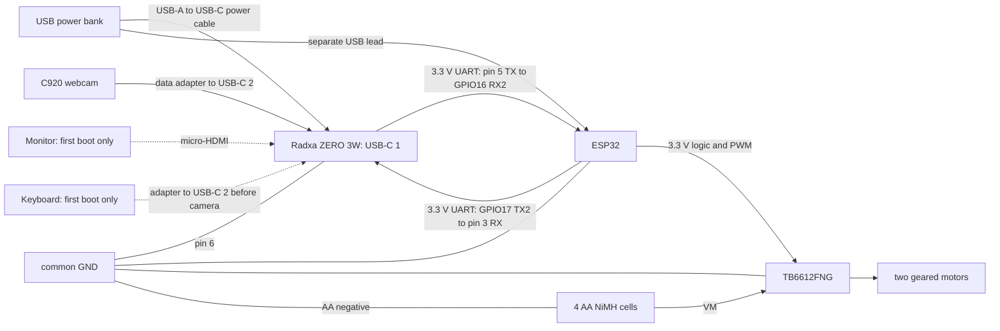

# Proposed Prototype 1 wiring

**Planned and untested.** This keeps the ESP32 connections from the original
brief and changes the logic board to Radxa ZERO 3W. Check the actual board
labels before connecting power. ESP32 GPIO numbers and Radxa physical header
pin numbers are different numbering systems.

## Motor driver

| ESP32 / supply | TB6612FNG module |
| --- | --- |
| GPIO25 | PWMA |
| GPIO26 | AIN1 |
| GPIO27 | AIN2 |
| GPIO13 | PWMB |
| GPIO32 | BIN1 |
| GPIO33 | BIN2 |
| GPIO4 | STBY |
| 3V3 | Logic VCC |
| AA pack positive, about 4.8 V nominal with four NiMH cells | VM |
| Common ground | GND |

Connect the left motor to AO1/AO2 and right motor to BO1/BO2. Module labels may
use A01/A02 and B01/B02. Direction will be checked with the wheels lifted in
milestone 2 and corrected in software if needed.

Put the 100 µF capacitor close to the driver across VM and GND. For an
electrolytic capacitor, positive goes to VM and the marked negative lead goes
to GND. Choose a voltage rating above the highest battery voltage.

## Encoders and sensors

| Part | Connection |
| --- | --- |
| Left LM393 digital output, DO | GPIO34 |
| Right LM393 digital output, DO | GPIO35 |
| Both encoder modules | VCC to 3V3, GND to common ground |
| MPU6050 and BME280 SDA | GPIO21 |
| MPU6050 and BME280 SCL | GPIO22 |
| Both I2C modules | VCC to 3V3, GND to common ground |
| Soil sensor analogue output, AO | GPIO39, ADC1 |
| Soil sensor supply | VCC to 3V3, GND to common ground |

GPIO34 and GPIO35 are input-only and have no internal pull-ups. Check whether
the selected encoder modules already provide a suitable output pull-up; an
open-collector output needs one to 3V3. Do not assume `INPUT_PULLUP` fixes this.
I2C pull-ups must also go to 3V3, not 5 V. Confirm module supply/output limits.

Keep the soil sensor's upper electronics and connector dry. Prototype 1 uses
manual probe insertion at a stop; it has no arm, sampler or insertion mechanism.
BME280 measures air conditions, not soil temperature or plant nutrients.

## UART between ESP32 and Radxa ZERO 3W

This is the planned UART3-M0 connection. The Radxa numbers below are physical
header pins, not GPIO numbers. TX crosses to the other board's RX.

| ESP32 | Direction | Radxa ZERO 3W header |
| --- | --- | --- |
| GPIO17, TX2 | → | Pin 3, UART3_RX_M0 |
| GPIO16, RX2 | ← | Pin 5, UART3_TX_M0 |
| GND | ↔ | Pin 6, GND |

Both boards use **3.3 V logic**. Use 115200 baud, 8 data bits, no parity and
one stop bit. Enable UART3-M0 through the `rsetup` overlays and reboot before
checking the serial device. `/dev/ttyS3` is the expected name, but it is
**unconfirmed until checked on the board**. Keep the port as a configuration
setting in the future logger. Check that the selected port has no console or
serial getty using it before connecting the ESP32.

Pins 3/5 also have I2C pull-ups on the board. UART3-M0 still needs a hardware
test; do not enable an I2C overlay that uses these pins at the same time.

These are planned fallbacks if UART3-M0 is unsuitable. Enable only the chosen
UART route, update the port setting and verify its device name before use.

| Fallback overlay | ESP32 GPIO17, TX2 → Radxa RX | ESP32 GPIO16, RX2 ← Radxa TX | Common GND |
| --- | --- | --- | --- |
| UART4-M1 | Pin 16, UART4_RX_M1 | Pin 18, UART4_TX_M1 | Pin 20 |
| UART5-M1 | Pin 33, UART5_RX_M1 | Pin 32, UART5_TX_M1 | Pin 34 |

Avoid Radxa pins **8/10**, which are the UART2 debug console, and **27/28**.
Avoid ESP32 GPIO12, which is a boot strapping pin. These Radxa restrictions
do not refer to ESP32 GPIO numbers; GPIO27 still connects to AIN2 above.

Do the [milestone 0 checks](../docs/plan.md#milestone-0-checks-before-wiring)
before connecting the UART wires. No route has been tested yet.

## Power and mounting

- Power bank output, rated at least 5 V / 2 A, to Radxa **USB-C 1** through
  the USB-A to USB-C power cable.
- ESP32 on its own USB lead, ideally from a second power bank output. Check
  whether its connector is micro-USB or USB-C; use a data-capable cable for
  programming. Disconnect the power bank lead when connecting it to the computer.
- C920 to Radxa **USB-C 2**, the USB host port, through a data-capable USB-C
  to USB-A adapter.
- Micro-HDMI to a monitor and a USB keyboard on USB-C 2 through an adapter
  for first boot only. Unplug the keyboard before using that port for the C920.
- AA pack positive to driver VM; AA negative to the common ground.
- Join Radxa pin 6, ESP32, driver, encoder and sensor grounds together.

The power bank does not feed driver VM or the motors. **Do not power the ESP32
from Radxa header pins 2/4 until their voltage has been measured and the supply
path has been checked.** A 5 V reading alone does not establish the available
current or protection. The planned build keeps pins 2/4 disconnected and uses
the ESP32's own USB lead.

This diagram is proposed wiring, not proof that a powered build has passed.

Bolt the Radxa and ESP32 to standoffs on the chassis or a top plate. Radxa
mounting hole spacing and heatsink fit are not verified; check them before
choosing the mounts. Strap the power bank and battery holder down with Velcro
and zip ties. Attach the C920
to a rigid bracket with a strap or clamp; its monitor clip alone needs checking
on the moving chassis. Strain-relieve cables so plugs cannot carry the load.
Replace loose breadboard motor-power connections with secure suitable joints
before floor trials. Keep the centre of mass low and check stability while
stationary before testing movement.

Mounting strength, wheel traction, motor stall current and runtime have not
been measured. These checks belong to the real hardware milestones.

Reference: [ESP32 GPIO documentation](https://docs.espressif.com/projects/esp-idf/en/stable/esp32/api-reference/peripherals/gpio.html)
and [Radxa ZERO 3 hardware interface](https://docs.radxa.com/en/zero/zero3/hardware-design/hardware-interface).
See the [Radxa rsetup guide](https://docs.radxa.com/en/zero/zero3/radxa-os/rsetup)
for managing overlays; the options need checking on the installed image.
