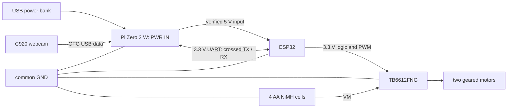

# Proposed Prototype 1 wiring

**Planned and untested.** This is copied from the original brief, with the
ground and mounting details made explicit. Check the actual board labels
before connecting power. ESP32 GPIO numbers and Pi physical header pin numbers
are different numbering systems.

## Motor driver

| ESP32 / supply | TB6612FNG module |
| --- | --- |
| GPIO25 | PWMA |
| GPIO26 | AIN1 |
| GPIO27 | AIN2 |
| GPIO13 | PWMB |
| GPIO32 | BIN1 |
| GPIO33 | BIN2 |
| GPIO4 | STBY |
| 3V3 | Logic VCC |
| AA pack positive, about 4.8 V nominal with four NiMH cells | VM |
| Common ground | GND |

Connect the left motor to AO1/AO2 and right motor to BO1/BO2. Module labels may
use A01/A02 and B01/B02. Direction will be checked with the wheels lifted in
milestone 2 and corrected in software if needed.

Put the 100 µF capacitor close to the driver across VM and GND. For an
electrolytic capacitor, positive goes to VM and the marked negative lead goes
to GND. Choose a voltage rating above the highest battery voltage.

## Encoders and sensors

| Part | Connection |
| --- | --- |
| Left LM393 digital output, DO | GPIO34 |
| Right LM393 digital output, DO | GPIO35 |
| Both encoder modules | VCC to 3V3, GND to common ground |
| MPU6050 and BME280 SDA | GPIO21 |
| MPU6050 and BME280 SCL | GPIO22 |
| Both I2C modules | VCC to 3V3, GND to common ground |
| Soil sensor analogue output, AO | GPIO39, ADC1 |
| Soil sensor supply | VCC to 3V3, GND to common ground |

GPIO34 and GPIO35 are input-only and have no internal pull-ups. Check whether
the selected encoder modules already provide a suitable output pull-up; an
open-collector output needs one to 3V3. Do not assume `INPUT_PULLUP` fixes this.
I2C pull-ups must also go to 3V3, not 5 V. Confirm module supply/output limits.

Keep the soil sensor's upper electronics and connector dry. Prototype 1 uses
manual probe insertion at a stop; it has no arm, sampler or insertion mechanism.
BME280 measures air conditions, not soil temperature or plant nutrients.

## UART between ESP32 and Pi

| ESP32 | Raspberry Pi Zero 2 W |
| --- | --- |
| TX2, GPIO17 | RXD, GPIO15, physical pin 10 |
| RX2, GPIO16 | TXD, GPIO14, physical pin 8 |
| GND | GND, physical pin 6 |

TX connects to the other board's RX. Both use 3.3 V logic. Use 115200 baud,
8 data bits, no parity and one stop bit. Disable the Pi serial console before
using the UART. Avoid ESP32 GPIO12, which is a boot strapping pin.

## Power and mounting

- Power bank USB output to the Pi's **PWR IN** micro-USB port.
- Pi 5 V, physical pin 2, to the ESP32 board's verified 5 V/VIN input.
- Camera to the Pi's **USB data** micro-USB port through the OTG adapter.
- AA pack positive to driver VM; AA negative to the common ground.
- Join Pi, ESP32, driver, encoder and sensor grounds together.

The Pi's power supply does not feed driver VM or the motors. Verify what VIN
means on the chosen ESP32 DevKit. When using its USB port for programming,
disconnect the Pi-to-ESP32 5 V wire unless the board's documented power circuit
allows both sources; clone boards can differ.

This diagram is proposed wiring, not proof that a powered build has passed.

Bolt the Pi and ESP32 to standoffs on the chassis or a top plate. Strap the
power bank and battery holder down with Velcro and zip ties. Attach the C920
to a rigid bracket with a strap or clamp; its monitor clip alone needs checking
on the moving chassis. Strain-relieve cables so plugs cannot carry the load.
Replace loose breadboard motor-power connections with secure suitable joints
before floor trials. Keep the centre of mass low and check stability while
stationary before testing movement.

Mounting strength, wheel traction, motor stall current and runtime have not
been measured. These checks belong to the real hardware milestones.

Reference: [ESP32 GPIO documentation](https://docs.espressif.com/projects/esp-idf/en/stable/esp32/api-reference/peripherals/gpio.html)
and [Raspberry Pi hardware documentation](https://www.raspberrypi.com/documentation/computers/raspberry-pi.html).
