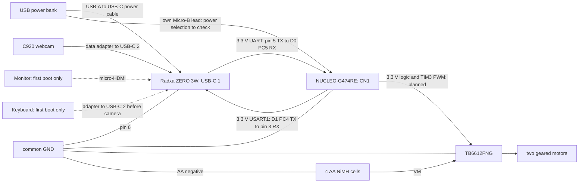

# Proposed Prototype 1 wiring

**Planned and untested.** The real-time controller is NUCLEO-G474RE and the
logic board is Radxa ZERO 3W. No hardware milestone has passed. This is a pin
plan from ST's UM2505 Rev 7, the STM32G474 datasheet and the MB1367-G474RE-D01
schematic, not a checked physical build.

I will check each pin against the board's user manual, actual revision and
module labels before wiring. **Check on the board** that its solder bridges
match the documented default routing. Nucleo D/A labels, MCU names such as
PC4, connector positions and Radxa physical pin numbers are different labels.

All signal connections and module logic are **3.3 V**. USB power is 5 V;
the motor supply is separate. **PA3 and PC5 are not 5 V tolerant.** Analogue
inputs must also stay within the actual ADC reference and supply limits.

## Nucleo pin plan

These are proposed assignments for later milestones. Milestone 1 uses none
of these header wires. Arduino connectors CN5/CN6/CN8/CN9 are female sockets;
ST morpho CN7/CN10 are male pins. Buy a mixed jumper pack: male-to-female for
Arduino sockets to male module pins, female-to-female for morpho or Radxa pins.

| Function | Nucleo label | MCU pin | Connector position | Planned use |
| --- | --- | --- | --- | --- |
| Left motor PWMA | D12 | PA6 | CN5 pin 5 | TIM3_CH1 PWM, AF2 |
| Left motor AIN1 | D6 | PB10 | CN9 pin 7 | Digital output |
| Left motor AIN2 | D7 | PA8 | CN9 pin 8 | Digital output |
| Right motor PWMB | D9 | PC7 | CN5 pin 2 | TIM3_CH2 PWM, AF2 |
| Right motor BIN1 | D8 | PA9 | CN5 pin 1 | Digital output |
| Right motor BIN2 | D11 | PA7 | CN5 pin 4 | Digital output |
| Driver STBY | A2 | PA4 | CN8 pin 3 | Digital output; A2 can also be used as GPIO |
| Left LM393 output DO | D2 | PA10 | CN9 pin 3 | EXTI10 pulse interrupt |
| Right LM393 output DO | D4 | PB5 | CN9 pin 5 | EXTI5 pulse interrupt |
| MPU6050 and BME280 SDA | D14 / SDA | PB9 | CN5 pin 9 | I2C1 SDA, AF4 |
| MPU6050 and BME280 SCL | D15 / SCL | PB8 | CN5 pin 10 | I2C1 SCL, AF4 |
| Soil sensor AO | A0 | PA0 | CN8 pin 1 | ADC1/2 input 1; later configure 12-bit reads |
| Spare light-sensor input | A1 | PA1 | CN8 pin 2 | Reserved input; sensor type and circuit not chosen |
| Radxa link TX | D1 | PC4 | CN9 pin 2 | USART1 TX, AF7 |
| Radxa link RX | D0 | PC5 | CN9 pin 1 | USART1 RX, AF7 |
| Module logic supply | 3V3 | Supply | CN6 pin 4 | Check voltage and total module load before connecting |
| Common ground | GND | Ground | CN6 pin 6 or 7 | Also available at morpho CN10 pin 20 |

Both PWM outputs are separate TIM3 channels. They can share a PWM frequency
with different duties. The later motor code must select and check TIM3
explicitly; PWM frequency is separate from the proposed 100 Hz control loop.
No PWM frequency or motor behaviour has been tested.

Reserve **PA2/PA3 for the ST-LINK VCP, PA13/PA14 for SWD and PB3 / D3 for SWO**.
Do not use them for the motor driver or sensors. The pin plan also leaves
PB4 / D5 and PB6 / D10 unused; the datasheet notes their UCPD-related behaviour.
Check the default user-button routing before using A0; PA0 can be connected
to that button by an alternative solder-bridge configuration.

## Motor driver

Connect the proposed driver signals above only when milestone 2 starts.
Driver logic VCC goes to checked Nucleo 3V3, VM to AA positive, and GND to
the common ground. Four NiMH cells give about 4.8 V nominal, not a fixed voltage.
Connect the left motor to AO1/AO2 and the right to BO1/BO2. Module labels may
use A01/A02 and B01/B02. Check directions with the wheels lifted and correct
any reversal in software.

Put the 100 µF capacitor close to the driver across VM and GND. Its positive
lead goes to VM and its marked negative lead to GND. Choose a voltage rating
above the highest battery voltage. Measure motor stall current against the
chosen driver's limits before driving trials.

## Encoders and sensors

Power the LM393, MPU6050, BME280 and soil modules from checked 3V3, with a
common ground, only after their exact supply and output limits are verified.
An LM393 open-collector output needs a pull-up to 3V3; check whether the module
already has one. I2C pull-ups must also go to 3V3, not 5 V. A module's supply
label alone does not establish its output voltage.

The LM393 modules give **one pulse signal per wheel**, not quadrature A/B.
Prototype 1 will count one selected edge with interrupts first. Keep the raw
counts increasing in both directions. Take direction from the accepted motor
command only as an assumption for later speed calculations; it can be wrong
while coasting, reversing or being pushed. Measure counts per wheel turn.
The hardware quadrature decoder will not be used in Prototype 1.

A separate later milestone will test timer-based pulse counting and magnetic
quadrature encoders. That needs a new pin plan and its own pass test. The
STM32duino `HardwareTimer` API has no encoder mode, so quadrature configuration
needs lower-level HAL or LL calls. It is not implemented here.

The soil ADC is planned for 12-bit values, 0–4095, keeping the existing schema.
Check the analogue voltage against the actual VREF+/VDDA before connection.
The manual describes a default reference around 3.25 V, so do not assume a
full 3.3 V analogue signal is within the measurement range. Reference jumper
and solder-bridge settings need checking on the board; do not change them yet.
Keep the probe electronics and connector dry. Probe insertion is manual at a
stop. BME280 measures air conditions, not soil temperature or plant nutrients.

## UART between Nucleo and Radxa ZERO 3W

This is the planned USART1 to UART3-M0 connection. TX crosses to RX.
The Radxa numbers are physical header pins.

| NUCLEO-G474RE | Direction | Radxa ZERO 3W header |
| --- | --- | --- |
| D1 / PC4, USART1 TX, CN9 pin 2 | → | Pin 3, UART3_RX_M0 |
| D0 / PC5, USART1 RX, CN9 pin 1 | ← | Pin 5, UART3_TX_M0 |
| GND, CN6 pin 6 or 7 | ↔ | Pin 6, GND |

Use **3.3 V logic**, 115200 baud, 8 data bits, no parity and one stop bit.
Enable UART3-M0 through the `rsetup` overlays and reboot. `/dev/ttyS3` is
expected but **unconfirmed until checked on the board**. Keep the port as a
logger config setting and check it has no console or serial getty before
connecting. Pins 3/5 have I2C pull-ups; do not also enable an I2C overlay there.

ST's default routing puts USART1 on D1/D0 and LPUART1 on the ST-LINK VCP.
The D1/D0 route can be changed by solder bridges. **Check on the board** that
it matches UM2505 tables 10/11; do not move bridges based only on a pin label.
PC tests will later use the same D/STOP and T protocol over the VCP. Today's
counter firmware only prints diagnostic text and leaves USART1 uninitialised.

The Radxa fallbacks are unchanged. Enable only the chosen route, update the
port setting and verify its device name before use.

| Fallback overlay | Nucleo D1 / PC4 TX → Radxa RX | Nucleo D0 / PC5 RX ← Radxa TX | Common Radxa GND |
| --- | --- | --- | --- |
| UART4-M1 | Pin 16, UART4_RX_M1 | Pin 18, UART4_TX_M1 | Pin 20 |
| UART5-M1 | Pin 33, UART5_RX_M1 | Pin 32, UART5_TX_M1 | Pin 34 |

Avoid Radxa pins **8/10**, the UART2 debug console, and **27/28**.
Do the [milestone 0 checks](../docs/plan.md#milestone-0-checks-before-wiring)
before connecting UART wires. No route has been tested.

## Power and mounting

- Power bank output rated at least 5 V / 2 A to Radxa **USB-C 1** through a
  USB-A to USB-C power cable. Check the bank's combined and per-output limits.
- Nucleo on its own data-capable **Micro-B USB lead to CN1**, ideally from a
  separate bank output. Standalone bank power is planned, not verified. The
  default ST-LINK power path depends on USB enumeration, so a charger or bank
  may need a different power-source selection. **Do not move any jumper until
  the schematic for the actual board revision has been checked.**
- C920 to Radxa **USB-C 2** through a data-capable USB-C to USB-A adapter.
- Micro-HDMI and a USB keyboard for Radxa first boot only. Unplug the keyboard
  before using USB-C 2 for the C920.
- AA positive to driver VM; AA negative to common ground. The logic bank does
  not feed driver VM or the motors.
- Join Radxa pin 6, Nucleo, driver, encoder and sensor grounds together.

UM2505's table 4 and D01 schematic call the power selector **JP5**, but some
power paragraphs call it **JP2**. Those names are inconsistent. Identify the
revision and printed labels first; this plan is not an instruction to move a
jumper. Confirm standalone bank operation before relying on it on the rover.
Use one Nucleo power source at a time. Disconnect the bank lead before
connecting computer USB; do not add a header supply alongside USB.

**Do not power the Nucleo from Radxa header pins 2/4 until measured and the
supply path checked.** Voltage alone does not establish current or protection.
The proposed build keeps those pins disconnected and uses separate USB leads.

This diagram is proposed wiring, not a powered test result. Bolt both boards
to standoffs on a chassis or top plate after measuring their mounting holes.
The Nucleo has a larger footprint than the earlier controller plan; chassis
clearance, mounting and heatsink fit still need checking. Strap the power bank
and battery holder down. Attach the C920 to a rigid bracket with a strap or
clamp and strain-relieve cables. Secure motor-power joints before floor trials.
Keep the centre of mass low and check stability before movement.

References, all still needing comparison with the delivered board:

- [ST UM2505 Rev 7](https://www.st.com/resource/en/user_manual/um2505-stm32g4-nucleo64-boards-mb1367-stmicroelectronics.pdf), tables 4, 10/11, 15/16 and connector figure 18.
- [STM32G474 datasheet](https://www.st.com/resource/en/datasheet/stm32g474re.pdf), tables 12/13 for pin limits and alternate functions.
- [MB1367-G474RE-D01 schematic](https://www.st.com/resource/en/schematic_pack/mb1367-g474re-d01-schematic.pdf), Arduino/morpho connections and power selector.
- [STM32duino HardwareTimer API](https://github.com/stm32duino/Arduino_Core_STM32/wiki/HardwareTimer-library).
- [Radxa ZERO 3 hardware interface](https://docs.radxa.com/en/zero/zero3/hardware-design/hardware-interface) and [rsetup overlays](https://docs.radxa.com/en/zero/zero3/radxa-os/rsetup).
