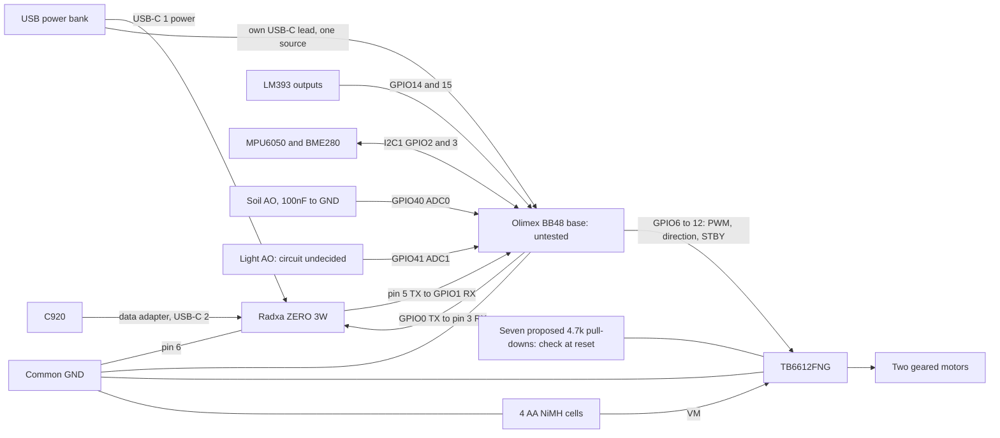

# Proposed Prototype 1 wiring

**Planned and untested. No hardware milestone has passed.** I'm using the
base Olimex RP2350-PICO2-BB48 as the controller and keeping Radxa ZERO 3W as
the computer. This is a proposed pin plan, not an as-built record.

I'll check the revision, fitted headers and module labels before wiring.
Numbers below are BB48 GPIOs; EXT1/EXT2 are Olimex header positions. Radxa
numbers are physical header pins. All signal logic is **3.3 V only**. USB
power is 5 V; motors have their own supply. Never put 5 V on a GPIO.

## BB48 pin plan

Milestone 1 uses only computer USB. Header wires stay disconnected. The plan
uses the [Olimex pinout][pinout], [Rev A schematic][schematic] and
[Arduino-Pico variant][variant]. Fitted male headers use F-F jumpers to other
male pins; check the delivered board rather than assuming a photo.

| Function | BB48 GPIO | Header position | Planned use, hardware untested |
| --- | --- | --- | --- |
| Radxa link TX | 0 | EXT1 pin 4 | UART0 TX, Arduino `Serial1` |
| Radxa link RX | 1 | EXT1 pin 5 | UART0 RX, Arduino `Serial1` |
| MPU6050 and BME280 SDA | 2 | EXT1 pin 6 | I2C1 SDA, Arduino `Wire1` |
| MPU6050 and BME280 SCL | 3 | EXT1 pin 7 | I2C1 SCL, Arduino `Wire1` |
| Left motor PWMA | 6 | EXT1 pin 10 | PWM slice 3, channel A |
| Left motor AIN1 | 7 | EXT1 pin 11 | Digital output |
| Left motor AIN2 | 8 | EXT1 pin 12 | Digital output; base board only |
| Right motor PWMB | 9 | EXT1 pin 13 | PWM slice 4, channel B |
| Right motor BIN1 | 10 | EXT1 pin 14 | Digital output; base board only |
| Right motor BIN2 | 11 | EXT1 pin 15 | Digital output; base board only |
| Driver STBY | 12 | EXT1 pin 16 | Digital output; external pull-down |
| Left LM393 output DO | 14 | EXT1 pin 18 | Single-pulse interrupt input |
| Right LM393 output DO | 15 | EXT1 pin 19 | Single-pulse interrupt input |
| Soil sensor AO | 40 | EXT2 pin 20 | ADC0; later set 12-bit reads |
| Light sensor AO | 41 | EXT2 pin 21 | ADC1; circuit still to be selected |
| Checked module supply | 3V3 | EXT1 pin 1 | Measure voltage and total module current |
| Common ground | GND | EXT1 pin 2 or EXT2 pin 3 | Join Radxa, driver, sensors and AA negative |

This is for **base BB48**, not BB48R. The R adds PSRAM on GPIO8 and SD
connections on GPIO9/10/11/24, conflicting with this motor plan. The base has
neither PSRAM nor a microSD socket. Leave GPIO25 for the onboard LED and
SWDIO/SWCLK and BOOT/RESET for board functions.

Use `Wire1` GPIO2/3 for sensors. Default `Wire` and QWST use GPIO12/13, so
**leave QWST empty**: GPIO12 is STBY. The pUEXT connector also shares UART0
and SPI pins with this plan. Leave it empty until shared signals are reviewed.
Don't start default SPI or `Serial2` on motor pins. These are later firmware
choices, not peripherals initialised by today's counter.

Wheel PWM pins use separate slices. Later code must check frequency/duty
range; no PWM frequency has been selected or measured. [SDK PWM mapping][pwm]

## Pins kept for later

**Planned reservations only, untested and unimplemented.** This is a starting
allocation. Review circuits, loads and pin sharing at each later milestone.

| Later function | Reserved GPIOs | Planned use |
| --- | --- | --- |
| Probe actuator | 16 PWM, 17/18 direction; 19/20 limits | Separate driver; PWM slice 0 A |
| Hatch | 21 control, 22 limit | Servo or driver still undecided; PWM slice 2 B |
| E-stop status | 23 | Sense only; physical e-stop separately cuts motor power |
| Camera mast | 26 control, 27 limit | Servo or driver still undecided; PWM slice 5 A |
| Two more single-pulse encoders | 28/29 | Four wheels later; quadrature needs another pin review |
| Headlamp | 30 | PWM slice 7 A through a suitable driver |
| Bumper or bed-edge input | 31 | Sensor and fault circuit still undecided |
| SPI expansion, possibly external CAN controller plus transceiver | 32 RX, 33 CS, 34 SCK, 35 TX; 38 interrupt | Set SPI0 pins explicitly; no native CAN is assumed |
| GNSS | 36 TX, 37 RX | UART1; set `Serial2` pins explicitly |
| Pump or valve control | 39 | External driver and separate load supply |
| Battery voltage and further analog sensors | 42–47 | ADC2–ADC7; divider/protection/reference not designed |
| Other spare pins | 4/5, 13, 24 | Review shared functions before use |

These proposed actuator PWM slices differ from the wheel slices. Libraries,
servo timing and the complete allocation still need bench tests.

## Motor driver and reset defaults

At milestone 2, driver VCC goes to checked BB48 3V3 and VM to separate AA
positive. Left motor uses AO1/AO2; right uses BO1/BO2. Put a correctly rated
100 µF capacitor across VM/GND near the driver, with correct polarity.
Measure motor start/stall requirements against the actual driver's limits.

Plan one **4.7 kΩ pull-down, ±5% or better, to GND at STBY, PWMA, PWMB,
AIN1, AIN2, BIN1 and BIN2**: seven resistors, at driver inputs. The value is
a proposal until measured; all wiring is planned and untested. Check module
pull-ups. The chip has weaker internal pull-downs; STBY low gives standby,
not active braking.
[Toshiba TB6612 data sheet][tb6612]

**Check A2 versus A4 silicon before relying on those resistors.** A2 has E9
input leakage when the input buffer is enabled, the output buffer is disabled
and the pad voltage is in the undefined logic region. The data sheet allows
an external pull-down of **8.2 kΩ or less**. At +5% tolerance, 4.7 kΩ becomes
**4.935 kΩ**, leaving 3.265 kΩ (about 40%) below that limit. Confirm the
resistor tolerance and measure the actual circuit; the calculation doesn't
prove motor-off behaviour. [RP2350 errata, E9][rp2350]

E9 doesn't affect pull-downs immediately after power-on or RUN reset while
input-enable is clear. Later pin configuration still needs checking. Measure
STBY and other inputs at power-up, RESET, BOOT and USB disconnect with VM
disconnected. Revise the circuit before motor power if low isn't assured.
A4 is unaffected by E9, but the same reset checks still apply.
[RP2350 errata, E9][rp2350], [A4 announcement][a4]

The present counter implements no motor commands or timeout. Later firmware
needs STBY low at startup, a local command timeout and deliberate rearm.
Pull-downs can't override software driving high. The physical e-stop must
cut motor power independently; its circuit is not designed yet.

## Encoders and analog readings

Check module supplies and outputs first. Open-collector encoders need
pull-ups to 3V3, possibly already fitted. I2C pull-ups also go to 3V3. Count
one selected edge per wheel first; keep raw counts cumulative and increasing.
Command direction is only an assumption while coasting, reversing or being
pushed. Measure counts per turn. PIO counting and magnetic A/B encoders are
a separate later milestone.

GPIO40/41 are ADC0/ADC1 on this RP2350B board. Later use
`analogReadResolution(12)` so `soil_raw` stays 0–4095. No light column is added.
Measure the actual analog supply/reference and sensor output; don't reuse
the old controller's assumed reference. Plan a **100 nF ceramic capacitor
from GPIO40 to GND**, near the ADC pin. Settling/source loading is untested.
Check the ADC pad input-buffer configuration for A2 and compare readings
with motors off and on. Keep probe electronics dry. P1 insertion is manual
at a stop. Air readings are not soil readings. Missing values stay empty.

## UART between BB48 and Radxa ZERO 3W

This is **BB48 UART0 to Radxa UART3-M0**, not Radxa UART0. TX crosses to RX.

| BB48 | Direction | Radxa physical header pin |
| --- | --- | --- |
| GPIO0, UART0 TX, EXT1 pin 4 | → | 3, UART3_RX_M0 |
| GPIO1, UART0 RX, EXT1 pin 5 | ← | 5, UART3_TX_M0 |
| GND, EXT1 pin 2 or EXT2 pin 3 | ↔ | 6, GND |

Use 3.3 V, 115200 baud, 8N1. Enable UART3-M0 through `rsetup`, reboot and check
the actual device and console/getty use. `/dev/ttyS3` is expected but
**unconfirmed**; logger port has no default. Pins 3/5 also have I2C pull-ups,
so don't enable their I2C overlay at the same time.

| Fallback overlay | GPIO0 TX → Radxa RX | GPIO1 RX ← Radxa TX | Radxa GND |
| --- | --- | --- | --- |
| UART4-M1 | Pin 16, UART4_RX_M1 | Pin 18, UART4_TX_M1 | Pin 20 |
| UART5-M1 | Pin 33, UART5_RX_M1 | Pin 32, UART5_TX_M1 | Pin 34 |

Avoid Radxa **8/10**, its UART2 debug console, and **27/28**. Fallbacks are
unchanged and untested. The PC counter uses native USB `Serial`; UART0 stays
uninitialised. Later firmware must select one command source. T/D/STOP and
the 256-byte maximum stay unchanged. [Radxa interface][radxa], [rsetup][rsetup]

## Power and mounting

- Bank to Radxa **USB-C 1** with a checked USB-A to USB-C power cable.
- BB48 on its own **USB-C data/power lead**, computer USB for milestone 1,
  then a checked separate bank output. One source at a time.
- C920 to Radxa **USB-C 2** through a data adapter. Hub optional only after
  measurements; keep the published **500 mA** host budget.
- Micro-HDMI and keyboard are for Radxa first boot only.
- AA positive feeds VM; AA negative joins common ground. Keep motor current
  out of thin signal jumpers and secure connections before movement.

The schematic shows USB VBUS through a diode to VSYS and the regulator,
without a host-controlled target-power gate. Bank startup/stay-on are still
untested. Olimex says **external VSYS input must not be used while USB is
connected**. Use USB for P1; later regulated 5 V/VSYS needs revision/polarity
checks. Keep Radxa header **2/4 disconnected** until measured and the supply
path checked. [Olimex power instructions][manual], [power plan](../docs/power_plan.md)

The diagram is planned and untested. Secure boards and battery holders,
strain-relieve cables and use a rigid camera bracket. Traction, mounting,
runtime and weather protection are unproved. See [bring-up checks](../docs/plan.md).

[pinout]: https://www.olimex.com/Products/RaspberryPi/PICO/RP2350-PICO2-BB48/resources/RP2350-PICO2-BB48-pinout.png
[schematic]: https://github.com/OLIMEX/RP2350-PICO2-BB48/blob/main/HARDWARE/RP2350-PICO2-BB48.REV.A/PICO2-BB48_Rev_A.pdf
[manual]: https://github.com/OLIMEX/RP2350-PICO2-BB48/blob/main/DOCUMENTS/RP2350-PICO2-BB48-user-manual.pdf
[variant]: https://github.com/earlephilhower/arduino-pico/blob/master/variants/olimex_pico2bb48/pins_arduino.h
[pwm]: https://github.com/raspberrypi/pico-sdk/blob/master/src/rp2_common/hardware_pwm/include/hardware/pwm.h
[rp2350]: https://pip-assets.raspberrypi.com/categories/1214-rp2350/documents/RP-008373-DS-2-rp2350-datasheet.pdf
[a4]: https://www.raspberrypi.com/news/rp2350-a4-rp2354-and-a-new-hacking-challenge/
[tb6612]: https://toshiba.semicon-storage.com/info/docget.jsp?did=10660&prodName=TB6612FNG
[radxa]: https://docs.radxa.com/en/zero/zero3/hardware-design/hardware-interface
[rsetup]: https://docs.radxa.com/en/zero/zero3/radxa-os/rsetup
